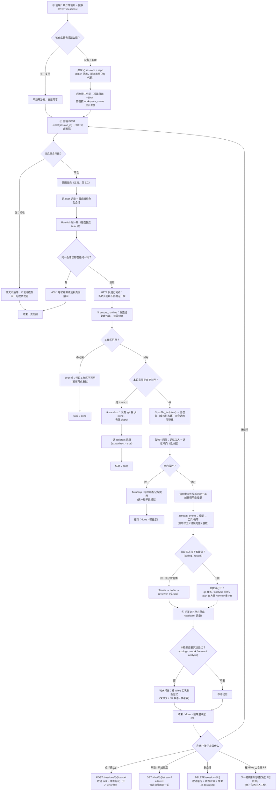
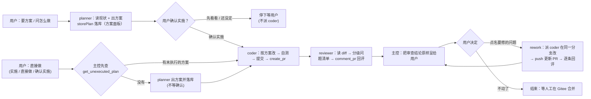
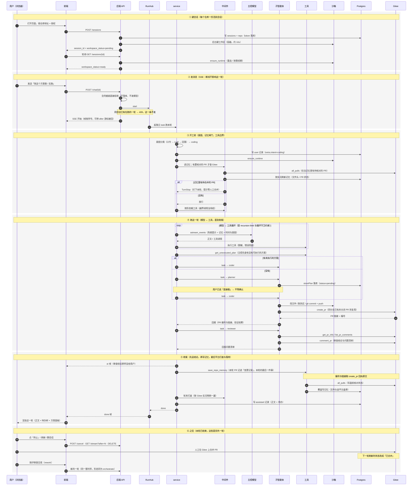

# 业务流程图：从新建会话到一轮结束

这张图回答一个问题：**用户按下「发送」之后，系统里到底发生了什么、在哪些地方分叉**。
图的依据是代码本身（每一步末尾都标了落在哪个文件），不是设计意图 —— 改流程时请连同本文一起改。

> 渲染：下面用的是 Mermaid。在 Gitee 仓库页、VS Code（装 Mermaid 插件）或支持 Mermaid 的
> Markdown 阅读器里能直接看图；纯文本环境读源码也是完整的。

---

## 一、总览

---

## 二、分叉：意图怎么定

四关顺序不可颠倒（`server/intent.py`），因为「这轮该给谁干」直接决定工具子集与角色提示词：

| 关 | 判据 | 说明 |
| --- | --- | --- |
| 1. 口令直通 | 强关键字命中即定，**不调任何模型** | 「出方案」「实施」「按评审意见修改」「同步仓库」「刷新仓库记忆」…`sync` **只能**从这一关产出（它是直接执行路径，误判后果不是少条指令） |
| 2. JEV（SystemOne） | 口令没命中时问它：一个 `Choice` 问题、6 个候选意图（**不含 sync**） | 2026-09-27 起的主判定器；拿回选项 + 置信度 + 各候选概率，都进日志（`source=jev`）。自然措辞（「就按这个改吧」）与泛词歧义（「实现」「分析」）在这一关解决 |
| 3. 大模型判定 | JEV 没配 / 超时 / 报错 / 回了认不出的标签 | 退回原来那套「让对话模型回一个词 + 一句理由」的判定（`source=llm`） |
| 4. 回落关键字 | 两个模型都判不出来 | 退回纯关键字口径（强 + 弱 + 排除词）；**关键字也没命中就是 `coding`**（2026-09-27 起，此前是 `qa`） |

形状与工具子集（`agent/profiles.py` + `tools/register.py`）：

| 意图 | 形态 | 子智能体 | 主控特有的工具 |
| --- | --- | --- | --- |
| `qa` | `qa` | —— | `get_pr_info`、`list_pr_comments` |
| `analysis`（也接「刷新 / 更新仓库记忆」） | `analysis` | —— | `get_pr_info`、`list_pr_comments`、`save_repo_memory` |
| `plan` | `plan` | —— | `get_pr_info`、`storePlan`、`getPlan`、`updatePlan`、`updatePlanSteps`、`deletePlan` |
| `review` | `review` | —— | `get_pr_info`、`list_pr_comments`、`comment_pr`、`save_repo_memory` |
| `coding` | `orchestrate` | planner / coder / reviewer | `get_pr_info`、`list_pr_comments`、`comment_pr`、`close_pr`、`save_repo_memory` |
| `rework`（按评审意见改） | `orchestrate`（与 `coding` 共用装配） | 同上 | 同上 |
| `sync` | —— | —— | **不经智能体**，直接执行 |

---

## 三、分叉：记忆闸门（开工前）

挂在 `plan` / `orchestrate` 两个主控形态上（`agent/middleware/memory.py`），**拦不拦按本轮意图判**：

| 本轮意图 | 有未合入 PR | 没有未合入 PR |
| --- | --- | --- |
| `plan` / `coding` | **拦**：写清待合并清单，等人工合并后再来 | 放行 |
| `rework` | 放行（要改的就是那份开着的 PR） | **拦**：没有可修的对象 |
| `review` | 放行（要审的那个 PR 本身就是 open 的） | 放行 |

两个前提：① **查不到（Gitee 失败）= 拦下且一个字不写**（「查不到」既不能当成「有」，也不能当成「没有」）；
② **记忆里没有要核对的 PR 就不查**（省一次 Gitee 往返，判据先看记忆里记着的待合并 PR）——
唯一例外是从没写过记忆的仓库，那一档仍查一次。

---

## 四、分叉：coding / rework 的编排环路

两条入口的差别只有一处：**用户明确说要动手时，planner 落库后不等确认** —— 一路 coder → reviewer 跑完；
只是描述需求时，方案出来先停下等他点头。

同一张图里两处**平台兜底**：`create_pr` 是幂等的（同分支已有未关闭 PR 就复用并回显编号与链接），
所以「重新实施一轮」不会开出重复 PR；每轮收尾主控都要把本轮 PR 记进仓库记忆的「变更记录」，
编号与链接取 `create_pr` 回执原文（§六）。

---

## 五、coding 模式时序图（从用户访问到结束）

上面两张图看的是「有哪几条分支」；这张看的是**谁在什么时候找谁**（参与者从左到右）——
以「用户明确说要动手」那条路为例，一条竖线一个角色，全部落到实际调用上。

三点读图提醒：

1. **只有 ① 是「用户访问」**（建会话 + 沙箱），②～⑤ 是每一轮的重复动作；⑥ 里的三种操作各自是**独立请求**，
   不是这一轮的一部分。
2. **SSE 与运行是两条线**：`POST /chat` 返回的是订阅流，运行在 `RunHub` 自己的 task 里 —— 所以浏览器刷新
   只断订阅（② 里那条虚线），运行照跑到 ⑤ 收尾。
3. **平台与模型各写哪部分**：③ 与 ⑤ 的「轮末打底」是平台在写（文件头 / PR 状态），④ 里 coder 的
   `create_pr` 与 ⑤ 里 `save_repo_memory` 是模型在写 —— 分工见 §六。

> 同一张图另有一份 **draw.io 原生文件**：`docs/coding-sequence.drawio`（用 draw.io 直接打开即可编辑，
> 也可以另存为 `.drawio.svg` 嵌进文档）。它由 `scripts/make_drawio.py` 从同一份数据生成 —— 改图时
> 上面的 Mermaid 与那份 `.drawio` 一起改。

---

## 六、分叉：仓库记忆什么时候动

| 时机 | 谁做 | 动什么 |
| --- | --- | --- |
| 每个主控轮**开工前** | 平台（`MemoryMiddleware`） | 文件头（最后更新 / 最近 PR）、按 Gitee 实况把「待合并」改成「已合并 / 已关闭」、摘掉老模板的两张表；**没要核对的 PR 就不查** |
| coding / review / analysis **收尾** | 模型（`save_repo_memory`） | 「仓库基本信息」（变了才改）、「变更记录」（本轮 PR）、「当前缺口」（按模块） |
| coding / review / rework / analysis **轮末** | 平台（`_refresh_repo_memory` 打底） | 再按 Gitee 实况刷一遍文件头与 PR 状态 |
| 用户点名「刷新 / 更新仓库记忆」 | 模型（走 `analysis` 意图） | 先 `get_pr_info(state="all")` 拉全量 → 把记忆里**没有的 PR 补进「变更记录」** → 整篇写回 |

「当前缺口」是下一轮「该做什么」的唯一出处；「变更记录」以 PR 为角度（一次改动一定带着一个 PR，
PR 没建成就不写这条）。

---

## 七、失败与降级分支

| 情况 | 行为 | 在哪 |
| --- | --- | --- |
| 消息里含凭据 | 整条拒收：不进库（存脱敏版）、不发模型、不建沙箱 | `service.chat` 入口 |
| 同一会话已有在跑的一轮 | 409；配了 Redis 时**跨 worker 也拦得住** | `RunHub.start` + `RedisRunLock` |
| 工作区建不出来 / 重连失败 | error 帧「代码工作区不可用」+ done（可点重试） | `ensure_runtime` |
| Gitee 查询失败（闸门那条路） | 拦下本轮、不写记忆；提示先解决凭据/网络 | `refresh_memory`（中间件） |
| 主导模型挂了 | 切兜底模型（`FALLBACK_PROVIDER`）；连续失败到阈值**熔断**，冷却期内不再撞主导 | `FallbackMiddleware` |
| 模型全败 | error 帧；原始异常只进日志（脱敏） | `_run_agent` |
| 同一工具同参数反复调用 | 先警告一次；再重复即本轮收尾 | `LoopGuardMiddleware` |
| 主控没写清单就要派子智能体 | 拦下本次 `task`，回一条可读理由；补成功 `write_todos` 后放行 | `DelegationGateMiddleware` |
| 工具越界（不该它用的工具 / 不该写的目录） | 调用被拒，回一条可读理由让模型换做法 | `BoundaryMiddleware` |
| Redis 不可用 | 退回进程内实现（运行缓冲 / 运行权 / 熔断），记 warning（带这条命令的耗时）；**冷却 60s 后自己再试一次**，成功即恢复；`REDIS_REQUIRED=true` 则拒绝启动 | `redis_cache.build_redis` / `RedisBacked.run` |
| 平台侧 DB 不可用 | 请求 500（不重试）；**注意**：连接超时目前是操作系统默认值，隧道断掉时一次请求可能挂 130 秒 | `db/engine.py` |
| 浏览器刷新 / 断网 | 运行照跑；带 `after` 游标重订阅即可接回（缓冲有帧数上限与 TTL） | `RunHub.subscribe` |
| 用户点「终止」 | 取消本轮 task；已挂的订阅者干净收尾（**不产 error 帧**），库里记中断标记 | `RunHub.cancel` |

---

## 八、涉及的文件（按流程顺序）

| 步骤 | 代码 |
| --- | --- |
| 建会话 / 会话列表 / 删会话 | `api/routes/sessions.py`、`session/manager.py` |
| 消息入口、SSE 订阅 | `api/routes/chat.py`、`server/runs.py` |
| 凭据拒收、意图分类、分发、收尾 | `server/service.py`、`server/intent.py` |
| 运行宿主（断线不影响运行、跨 worker） | `server/runs.py`、`server/run_store.py` |
| 中间件（记忆 / 边界 / 委派闸门 / 循环守卫 / 兜底 / 脱敏） | `agent/middleware/*.py`、`agent/circuit.py` |
| 形态 → 提示词 / 工具 / 子智能体 | `agent/profiles.py`、`agent/prompts.py`、`tools/register.py` |
| 沙箱与工作区卷 | `sandbox/*.py` |
| 仓库记忆的写入口径 | `agent/middleware/memory.py`、`agent/memory_reconcile.py`、`tools/memory.py`、`docs/repo-memory-template.md` |
| 右侧栏「代码」面板（与沙箱解耦） | `repo_cache.py`、`api/routes/repo.py` |
