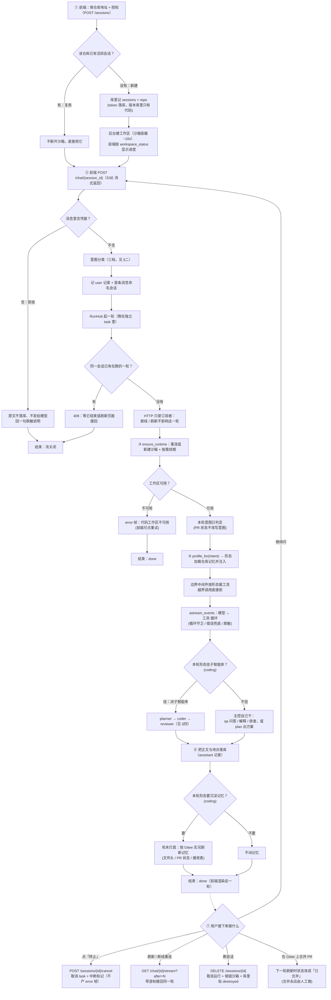
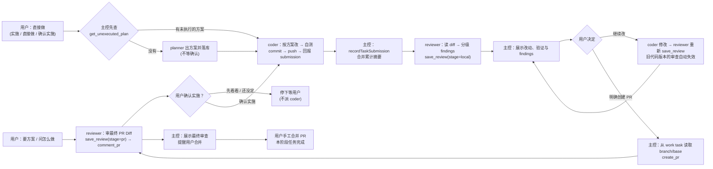
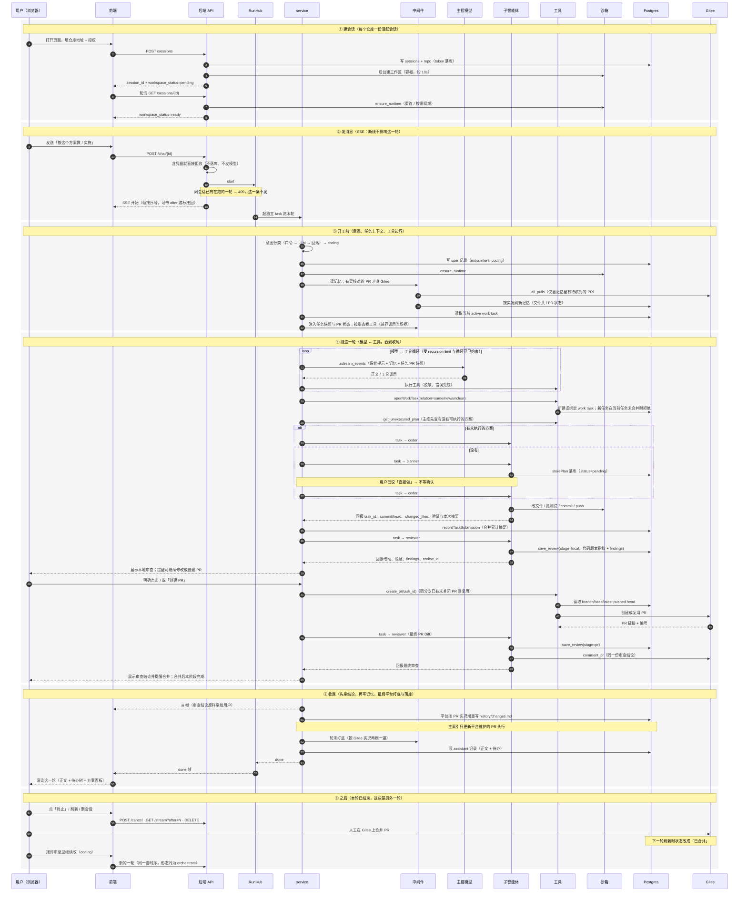

# 业务流程图：从新建会话到一轮结束

这张图回答一个问题：**用户按下「发送」之后，系统里到底发生了什么、在哪些地方分叉**。
图的依据是代码本身（每一步末尾都标了落在哪个文件），不是设计意图 —— 改流程时请连同本文一起改。

> 渲染：下面用的是 Mermaid。在 Gitee 仓库页、VS Code（装 Mermaid 插件）或支持 Mermaid 的
> Markdown 阅读器里能直接看图；纯文本环境读源码也是完整的。

---

## 一、总览

---

## 二、分叉：意图怎么定

先识别真实意图；PR 状态只作为上下文，写操作冲突由 work task 判断（`server/intent.py`）：

| 关 | 判据 | 说明 |
| --- | --- | --- |
| 1. 强口令 | 强关键字命中，**不调任何模型** | 「出方案」「实施」「按评审意见修改」等 |
| 2. JEV 或大模型 | 强口令没命中时只走设置页选中的一侧 | 上下文包含最近三个未中断完整轮次、其中的中断消息和本轮消息 |
| 失败 | 未配置 / 超时 / 报错 / 非法标签 / 低置信度 | 直接进入 `qa` 意图澄清，不使用弱关键字兜底，没有默认意图 |

PR 快照只提供事实用于工具执行，不参与意图分类，也不再作为授权门禁。

`qa` 对仓库工作区只读、不改变 PR，但可把经过代码验证的分析结论、缺口和风险写入仓库记忆，
其中缺口与风险必须带代码路径或验证提交，因此在任何 PR 状态下都执行。非本 Harness 登记的 open PR
只在快照中提示，不会自动阻断 coding。

形状与工具子集（`agent/profiles.py` + `tools/register.py`）：

| 意图 | 形态 | 子智能体 | 主控特有的工具 |
| --- | --- | --- | --- |
| `qa` | `qa` | —— | PR 只读、`read_repo_memory`、`save_repo_memory`、受控 `sync_repo_code`；可写 tmp 取证台账 |
| `plan` | `plan` | —— | PR 只读、`read_repo_memory`、方案 CRUD；不写仓库记忆 |
| `coding` | `orchestrate` | planner / coder / reviewer | PR 工具、work task 工具、仓库记忆索引/详情写入；`create_pr` 只在主控 |

---

## 三、PR 同步与任务冲突

轮首查最近 10 条全部状态 PR 与完整 open PR：前者用于记忆，新于记忆水印的 PR 用一次模型调用
批量摘要；后者用于 `pull_requests` 归属、方案关联、评论状态和工作区同步。已有 PR 按平台状态
对账，有变化就真实写回 StoreBackend。coding 轮末再走同一套同步。

外部 / 归属未知的 open PR 不再在分类前终止本轮。写代码前，主控调用 `openWorkTask`
给出 `same / new / unclear`：已有 active task 时，`same` 绑定当前任务；`new` 会被拒绝并
提示先完成当前任务、创建并合并 PR；`unclear` 只向用户确认一次。当前任务已有 PR，或用户
明确写 `#N` 时，平台先把工作区安全同步到 PR 最新 `head_sha`。`MemoryMiddleware` 只负责
加载同步后的记忆并注入。

### Git 中断审批

模型的 `execute` 命令在 BoundaryMiddleware 中先经过 Git 规范化策略：

- `allow`：状态、diff、add/commit、普通 push 等正常开发命令直接执行；
- `approval`：reset/clean/restore、历史改写、force-with-lease、非保护分支远端删除等，
  先保存 `.git/harness-recovery/` 快照，再通过 SSE `approval` 帧暂停当前 run；
- `deny`：filter-repo/filter-branch、reflog expire、gc --prune=now、mirror push、
  受保护分支强推/删除等直接返回 ToolMessage，不进入审批。

前端显示单选选择器：拒绝、允许本次执行、终止本轮。审批请求只更新 PG 中的
`git_approvals`，不调用 `POST /chat`，不新建 user record；当前 run 的 middleware
轮询到决定后继续同一 tool call。刷新页面会从 pending approval 恢复弹窗。

---

## 四、coding 的编排环路

两条入口的差别只有一处：**用户明确说要动手时，planner 落库后不等确认** —— 一路 coder → reviewer 跑完；
只是描述需求时，方案出来先停下等他点头。

Review 结论只供用户判断，不是 PR 门禁。主控结合当前 work task、最近三个完整轮次、中断消息
和本轮目标决定是继续修改还是交付 PR。`create_pr` 只校验 `task_id`、最新 commit/head 与
branch/base，本身幂等：同分支已有未关闭 PR 就复用。每轮真正建成 PR 后，主控才把编号与
链接写进仓库记忆的「变更记录」（§六）。

---

## 五、coding 模式时序图（从用户访问到结束）

上面两张图看的是「有哪几条分支」；这张看的是**谁在什么时候找谁**（参与者从左到右）——
以「用户明确说要动手」那条路为例，一条竖线一个角色，全部落到实际调用上。

三点读图提醒：

1. **只有 ① 是「用户访问」**（建会话 + 沙箱），②～⑤ 是每一轮的重复动作；⑥ 里的三种操作各自是**独立请求**，
   不是这一轮的一部分。
2. **SSE 与运行是两条线**：`POST /chat` 返回的是订阅流，运行在 `RunHub` 自己的 task 里 —— 所以浏览器刷新
   只断订阅（② 里那条虚线），运行照跑到 ⑤ 收尾。
3. **平台与模型各写哪部分**：③ 与 ⑤ 的「轮末打底」是平台在写（文件头 / PR 状态），④ 里主控的
   `create_pr` 与 ⑤ 里 `save_repo_memory` 是模型在写；coder 只负责 commit + push 与 submission
   数据 —— 分工见 §六。

> 同一张图另有一份 **draw.io 原生文件**：`docs/coding-sequence.drawio`（用 draw.io 直接打开即可编辑，
> 也可以另存为 `.drawio.svg` 嵌进文档）。它由 `scripts/make_drawio.py` 从同一份数据生成 —— 改图时
> 上面的 Mermaid 与那份 `.drawio` 一起改。

---

## 六、分叉：仓库记忆什么时候动

| 时机 | 谁做 | 动什么 |
| --- | --- | --- |
| 每轮**开工前** | 平台（`repo_state` / `repo_memory_sync`） | 查最近 10 条全部 PR 与完整 open PR；同步 PR 归属 / head 水位，新增 PR 批量摘要，已有 PR 修正状态 |
| coding **收尾** | 模型（文档级 `save_repo_memory`） | 主索引的基本信息/目录/架构摘要；缺口、约束、功能流程和时序 |
| coding **轮末** | 平台（`_refresh_repo_memory`） | 再走同一套最近 10 条 + open 全量同步，并更新 PR 表与记忆 |

`plan` 回合不触发记忆迁移、PR 记忆同步或详情写入；读取旧格式时只在内存中转换视图。

主索引只保留基本信息、语义目录、压缩架构和记忆目录；功能流程图、时序图、接口与历史在
子文档中按需加载。「当前缺口」用于判断下一轮该做什么；「变更记录」以 PR 为角度，
PR 没建成就不写这条。

---

## 七、失败与降级分支

| 情况 | 行为 | 在哪 |
| --- | --- | --- |
| 消息里含凭据 | 整条拒收：不进库（存脱敏版）、不发模型、不建沙箱 | `service.chat` 入口 |
| 同一会话已有在跑的一轮 | 409；配了 Redis 时**跨 worker 也拦得住** | `RunHub.start` + `RedisRunLock` |
| 工作区建不出来 / 重连失败 | error 帧「代码工作区不可用」+ done（可点重试） | `ensure_runtime` |
| Gitee 查询失败 | 分类与问答继续；记录失败状态，不能声称 PR 现状已知 | `repo_state` / 轮首同步 |
| 主导模型挂了 | 切兜底模型（`FALLBACK_PROVIDER`）；连续失败到阈值**熔断**，冷却期内不再撞主导 | `FallbackMiddleware` |
| 模型全败 | error 帧；原始异常只进日志（脱敏） | `_run_agent` |
| 同一工具同参数反复调用 | 先警告一次；再重复即本轮收尾 | `LoopGuardMiddleware` |
| 主控这一段没更新清单就要派子智能体 | 拦下本次 `task`，回一条可读理由；补一次 `write_todos` 后放行（每次派发都要有一段新的更新） | `DelegationGateMiddleware` |
| 工具越界（不该它用的工具 / 不该写的目录） | 调用被拒，回一条可读理由让模型换做法 | `BoundaryMiddleware` |
| Redis 不可用 | 退回进程内实现（运行缓冲 / 运行权 / 熔断），记 warning（带这条命令的耗时）；**冷却 60s 后自己再试一次**，成功即恢复；`REDIS_REQUIRED=true` 则拒绝启动 | `infra/redis_cache.build_redis` / `RedisBacked.run` |
| 平台侧 DB 不可用 | 请求 500（不重试）；**注意**：连接超时目前是操作系统默认值，隧道断掉时一次请求可能挂 130 秒 | `db/engine.py` |
| 浏览器刷新 / 断网 | 运行照跑；带 `after` 游标重订阅即可接回（缓冲有帧数上限与 TTL） | `RunHub.subscribe` |
| 用户点「终止」 | 取消本轮 task；已挂的订阅者干净收尾（**不产 error 帧**），库里记中断标记 | `RunHub.cancel` |

---

## 八、涉及的文件（按流程顺序）

| 步骤 | 代码 |
| --- | --- |
| 建会话 / 会话列表 / 删会话 | `api/routes/sessions.py`、`session/manager.py` |
| 消息入口、SSE 订阅 | `api/routes/chat.py`、`server/runs.py` |
| 凭据拒收、意图分类、分发、收尾 | `server/turn/*.py`（`HarnessService` 组合）、`server/intent.py` |
| 运行宿主（断线不影响运行、跨 worker） | `server/runs.py`、`server/run_store.py` |
| 中间件（记忆 / 边界 / 委派闸门 / 循环守卫 / 兜底 / 脱敏） | `agent/middleware/*.py`、`infra/circuit.py` |
| 形态 → 提示词 / 工具 / 子智能体 | `agent/profiles.py`、`agent/prompts.py`、`tools/register.py` |
| 沙箱与工作区卷 | `sandbox/*.py` |
| 仓库记忆的写入口径 | `agent/middleware/memory.py`、`agent/middleware/memory_reconcile.py`、`tools/memory.py`、`docs/repo-memory-template.md` |
| 右侧栏「代码」面板（与沙箱解耦） | `infra/repo_cache.py`、`api/routes/repo.py` |
