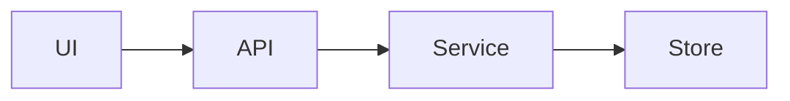

# 仓库记忆模版

> 本文件与 `sandbox/policies/repo-memory-template.md` 保持一致。仓库记忆采用
> **主索引 + 按需详情**：主索引每轮注入；功能流程、时序图、接口和历史在子文档中，
> 由智能体按路径读取。

---

# 仓库记忆：{owner}/{repo}

> 最后更新：{平台写盘时间}　｜　最近 PR：{平台回填}

## 一、仓库基本信息

- **项目地址**：{仓库地址}
- **技术栈**：{语言 / 框架 / 关键依赖}
- **启动方式**：{命令 + 前置依赖}
- **测试 / 构建**：{命令}
- **已知约定**：{版本、环境、编码规范依据、关键坑}

## 二、目录与模块

写**语义化目录导航**，不要倾倒完整文件树：

- **入口**：`{path}` — {职责}
- **核心模块**：`{path}` — {职责、对外接口、依赖方向}
- **测试**：`{path}` — {覆盖范围、夹具}
- **运行资源**：`{path}` — {迁移、部署、脚本、配置}

大仓库只展开 2～3 层；更深内容放模块或领域文档。

## 三、架构概览

只保留 10～20 个核心节点和依赖方向。可使用紧凑 Mermaid：



详细架构、部署拓扑和跨模块流程放 `architecture/*.md`。

## 四、记忆目录

由平台根据已写详情自动维护。推荐格式：

```text
- `architecture/overview.md` — 整体架构 ｜ 关键词：architecture, 系统结构
- `domains/payment.md` — 支付领域功能索引 ｜ 关键词：payment, 支付
- `features/refund.md` — 退款流程与时序 ｜ 关键词：refund, 退款, 回调
```

---

## 写入权限

- QA：可写经过代码验证的 profile、目录、架构、领域、功能、契约、运维、缺口和风险文档；
  缺口与风险必须提供 `source_paths` 或 `verified_commit`，不能写长期决策。
- Plan、planner、coder、reviewer：只读，不写仓库记忆。
- Coding 主控：可写分析文档、当前缺口、当前风险和长期约束；PR 历史由平台维护。

---

子文档仍沿用以下节标题：

```markdown
## 二、变更记录（最新在上）

### {日期} · {新增|修改|删除|修复} · {一句话摘要}
- **PR**：{#31}　｜　**状态**：{待合并 | 已合并 | 已关闭}

状态写入 `待合并`，之后由平台按代码平台实况改成 `已合并` / `已关闭`。
该节存放在 `history/changes.md`，只保留最近 8 条，细节看 PR。
这条**不写**：没有建成 PR，或没有可核对 PR 编号时，不写变更条目。

### 当前缺口

只记录**已确认缺失或尚未完成**的能力，不把潜在故障写进这里：

- **模块 / 目录**：{缺失的能力}
  - **状态**：{未开始 | 进行中 | 阻塞}
  - **证据**：`{src/path}`，说明缺口的判断依据

存放在 `working/gaps.md`，用 `save_repo_memory(kind="gaps", ...)` 更新。

### 当前风险

只记录可能造成安全、数据完整性、并发、兼容性、稳定性或运维等不利后果的问题。
风险不等于已经缺失的能力；同一事项既已缺失又会造成后果时，分别写清事实和后果。

- **风险**：{一句话}
  - **严重度**：{高 | 中 | 低}
  - **触发条件**：{在什么条件下发生}
  - **影响**：{会造成什么后果、影响范围}
  - **状态**：{待处理 | 已缓解 | 已接受}
  - **证据**：`{src/path}`，说明判断依据

存放在 `working/risks.md`，用 `save_repo_memory(kind="risks", ...)` 更新。

`gaps` 和 `risks` 都必须提供 `source_paths` 或 `verified_commit`。

### 长期约束

- **约束**：{一句话}　｜　**原因**：{为什么}　｜　**影响**：{以后哪件事要改变}

存放在 `working/decisions.md`，最多 8 条。QA 不能写长期决策。
```

---

## 详情文档结构

路径固定按类型分目录：

```text
architecture/  domains/  features/  contracts/
operations/    decisions/  working/  history/
```

### 功能文档

```markdown
# 功能名称
> 类型：feature ｜ 最后更新：...
> 主要领域：payment
> 关联领域：order, notification
> 摘要：...
> 关键词：...
> 验证提交：...
> 代码依据：`src/...`, `tests/...`

## 功能职责
## 入口与触发条件
## 主流程图
## 时序图
## 数据与接口
## 异常和补偿
## 已知缺口
## 测试与代码依据
```

流程图和时序图使用 Mermaid。一个功能一份文档，不拆成“一张图一个文件”。

### 其他文档

- `architecture/*.md`：整体架构、模块依赖、部署拓扑。
- `domains/*.md`：领域索引，列出领域下的功能路径。
- `contracts/*.md`：API、事件、CLI、数据模型和状态机。
- `operations/*.md`：启动、构建、测试、排障。
- `decisions/*.md`：ADR 和长期约束的详细原因。
- `working/gaps.md`：已确认的功能缺口与未完成能力。只写事实和代码证据。
- `working/risks.md`：安全、数据完整性、并发、兼容性等潜在不利后果。写清严重度、
  触发条件、影响、状态和代码证据。
- `working/decisions.md`：长期约束摘要。
- `history/changes.md`：按 PR 记录的近期变化，只保留短摘要。

写入统一使用文档级
`save_repo_memory(kind, slug, title, content, summary, domain, ...)`。不要让模型自由决定路径；
平台负责路径、长度、索引和 PR 状态。
