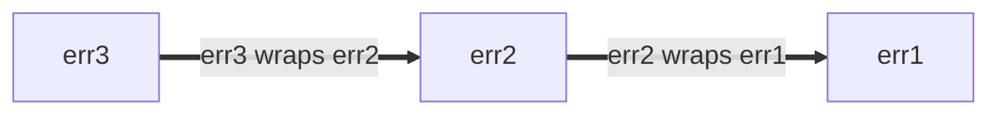

# Google Go 风格最佳实践

> 译自 Google 的 [Go Style Best Practices](https://google.github.io/styleguide/go/best-practices)，
> 原文以 [CC BY 3.0](https://creativecommons.org/licenses/by/3.0/) 许可发布。
> 本文件是其简体中文译本，供编码与审查时查阅：标题的层级与顺序照原文，
> 代码示例、标识符与注释一律保留英文原文。
>
> 原文对这四份文档的定位：本页**既非规范性、也非权威性**，是从属于[指南](go-style.md)的辅助文档。


**Note:** 这是 Google 一系列阐述 [Go 风格](go-style.md) 的文档中的一篇。本文**既非[规范性](go-style.md#normative)也非[权威](go-style.md#canonical)**，并且是[核心风格指南](go-style.md)的辅助文档。更多信息见[概述](go-style.md#about)。

<a id="about"></a>

## 关于

本文件记录了**关于如何最佳地运用 Go 风格指南的指导**。这些指导针对的是经常出现的常见情形，但可能并不适用于每一种情况。在可能的情况下，会一并讨论多种可选做法，以及决定何时适用、何时不适用它们的考量。

风格指南文档的完整集合见[概述](go-style.md#about)。

<a id="naming"></a>

## 命名

<a id="function-names"></a>

### 函数与方法名称

<a id="function-name-repetition"></a>

#### 避免重复冗余

在为函数或方法选择名称时，要考虑该名称将被阅读时所处的上下文。以下是避免调用点处过度[重复冗余](go-decisions.md#repetition)的建议：

*   以下内容通常可以从函数与方法名称中省略：

    *   输入与输出的类型（在没有冲突时）
    *   方法接收者的类型
    *   某个输入或输出是否为指针

*   对于函数，不要[重复包的名称](go-decisions.md#repetitive-with-package)。

    ```go
    // Bad:
    package yamlconfig

    func ParseYAMLConfig(input string) (*Config, error)
    ```

    ```go
    // Good:
    package yamlconfig

    func Parse(input string) (*Config, error)
    ```

*   对于方法，不要重复方法接收者的名称。

    ```go
    // Bad:
    func (c *Config) WriteConfigTo(w io.Writer) (int64, error)
    ```

    ```go
    // Good:
    func (c *Config) WriteTo(w io.Writer) (int64, error)
    ```

*   不要重复作为参数传入的变量名称。

    ```go
    // Bad:
    func OverrideFirstWithSecond(dest, source *Config) error
    ```

    ```go
    // Good:
    func Override(dest, source *Config) error
    ```

*   不要重复返回值的名称与类型。

    ```go
    // Bad:
    func TransformToJSON(input *Config) *jsonconfig.Config
    ```

    ```go
    // Good:
    func Transform(input *Config) *jsonconfig.Config
    ```

当有必要区分名称相似的函数时，可以额外附加一些信息。

```go
// Good:
func (c *Config) WriteTextTo(w io.Writer) (int64, error)
func (c *Config) WriteBinaryTo(w io.Writer) (int64, error)
```

<a id="function-name-conventions"></a>

#### 命名约定

在为函数与方法选择名称时，还有一些其他常见约定：

*   会返回某种东西的函数，取名词式的名称。

    ```go
    // Good:
    func (c *Config) JobName(key string) (value string, ok bool)
    ```

    由此得出的一个推论是：函数与方法名称应当[避免使用前缀 `Get`](go-decisions.md#getters)。

    ```go
    // Bad:
    func (c *Config) GetJobName(key string) (value string, ok bool)
    ```

*   会做某件事的函数，取动词式的名称。

    ```go
    // Good:
    func (c *Config) WriteDetail(w io.Writer) (int64, error)
    ```

*   仅因所涉类型而不同的同类函数，在名称末尾包含该类型的名称。

    ```go
    // Good:
    func ParseInt(input string) (int, error)
    func ParseInt64(input string) (int64, error)
    func AppendInt(buf []byte, value int) []byte
    func AppendInt64(buf []byte, value int64) []byte
    ```

    如果存在明确的「主要」版本，该版本的名称中可以省略类型：

    ```go
    // Good:
    func (c *Config) Marshal() ([]byte, error)
    func (c *Config) MarshalText() (string, error)
    ```

<a id="naming-doubles"></a>

### 测试替身与辅助包

在为提供测试辅助函数、尤其是[test doubles]的包和类型运用[naming]时，有若干条准则可以遵循。测试替身可以是 stub、fake、mock 或 spy。

这些示例大多使用 stub。如果你的代码使用 fake 或其他类型的测试替身，请相应地调整名称。

[naming]: go-style.md#naming
[test doubles]: https://abseil.io/resources/swe-book/html/ch13.html#basic_concepts

假设你有一个焦点明确、提供生产代码的包，类似下面这样：

```go
package creditcard

import (
    "errors"

    "path/to/money"
)

// ErrDeclined indicates that the issuer declines the charge.
var ErrDeclined = errors.New("creditcard: declined")

// Card contains information about a credit card, such as its issuer,
// expiration, and limit.
type Card struct {
    // omitted
}

// Service allows you to perform operations with credit cards against external
// payment processor vendors like charge, authorize, reimburse, and subscribe.
type Service struct {
    // omitted
}

func (s *Service) Charge(c *Card, amount money.Money) error { /* omitted */ }
```

<a id="naming-doubles-helper-package"></a>

#### 创建测试辅助包

假设你想创建一个包含另一个包的测试替身的包。本例中我们使用（上面的）`package creditcard`：

一种做法是在生产包的基础上引入一个新的 Go 包用于测试。一个稳妥的选择是在原包名后追加 `test` 一词（"creditcard" + "test"）：

```go
// Good:
package creditcardtest
```

除非另有明确说明，下面各节中的所有示例都位于 `package creditcardtest` 中。

<a id="naming-doubles-simple"></a>

#### 简单情形

你想为 `Service` 添加一组测试替身。由于 `Card` 实际上是一个哑数据类型，类似于 Protocol Buffer 消息，它在测试中不需要特殊处理，因此不需要替身。如果你预期只会为一种类型（比如 `Service`）做测试替身，那么可以采取一种简洁的方式来命名这些替身：

```go
// Good:
import (
    "path/to/creditcard"
    "path/to/money"
)

// Stub stubs creditcard.Service and provides no behavior of its own.
type Stub struct{}

func (Stub) Charge(*creditcard.Card, money.Money) error { return nil }
```

这绝对优于 `StubService` 这样的命名，更远胜于极糟糕的 `StubCreditCardService`，因为基础包名及其领域类型已经暗示了 `creditcardtest.Stub` 是什么。

最后，如果该包用 Bazel 构建，要确保为该包新增的 `go_library` 规则被标记为 `testonly`：

```build
# Good:
go_library(
    name = "creditcardtest",
    srcs = ["creditcardtest.go"],
    deps = [
        ":creditcard",
        ":money",
    ],
    testonly = True,
)
```

上述做法符合约定，其他工程师也能相当好地理解。

另见：

*   [Go Tip #42：为测试编写 Stub](go-style.md#gotip)

<a id="naming-doubles-multiple-behaviors"></a>

#### 多种测试替身行为

当一种 stub 不够用时（例如，你还需要一个总是失败的 stub），我们建议按照 stub 所模拟的行为来命名它们。这里我们把 `Stub` 重命名为 `AlwaysCharges`，并引入一个名为 `AlwaysDeclines` 的新 stub：

```go
// Good:
// AlwaysCharges stubs creditcard.Service and simulates success.
type AlwaysCharges struct{}

func (AlwaysCharges) Charge(*creditcard.Card, money.Money) error { return nil }

// AlwaysDeclines stubs creditcard.Service and simulates declined charges.
type AlwaysDeclines struct{}

func (AlwaysDeclines) Charge(*creditcard.Card, money.Money) error {
    return creditcard.ErrDeclined
}
```

<a id="naming-doubles-multiple-types"></a>

#### 为多种类型创建多个替身

但现在假设 `package creditcard` 包含多个值得为其创建替身的类型，如下面的 `Service` 和 `StoredValue` 所示：

```go
package creditcard

type Service struct {
    // omitted
}

type Card struct {
    // omitted
}

// StoredValue manages customer credit balances.  This applies when returned
// merchandise is credited to a customer's local account instead of processed
// by the credit issuer.  For this reason, it is implemented as a separate
// service.
type StoredValue struct {
    // omitted
}

func (s *StoredValue) Credit(c *Card, amount money.Money) error { /* omitted */ }
```

在这种情况下，更明确的测试替身命名是合理的：

```go
// Good:
type StubService struct{}

func (StubService) Charge(*creditcard.Card, money.Money) error { return nil }

type StubStoredValue struct{}

func (StubStoredValue) Credit(*creditcard.Card, money.Money) error { return nil }
```

<a id="naming-doubles-local-variables"></a>

#### 测试中的局部变量

当测试中的变量引用替身时，请根据上下文选择一个能最清楚地把该替身与其他生产类型区分开的名称。考虑一段你想测试的生产代码：

```go
package payment

import (
    "path/to/creditcard"
    "path/to/money"
)

type CreditCard interface {
    Charge(*creditcard.Card, money.Money) error
}

type Processor struct {
    CC CreditCard
}

var ErrBadInstrument = errors.New("payment: instrument is invalid or expired")

func (p *Processor) Process(c *creditcard.Card, amount money.Money) error {
    if c.Expired() {
        return ErrBadInstrument
    }
    return p.CC.Charge(c, amount)
}
```

在测试中，一个针对 `CreditCard` 的、称为「spy」的测试替身会与生产类型并列出现，因此给名称加前缀可能会提升清晰度。

```go
// Good:
package payment

import "path/to/creditcardtest"

func TestProcessor(t *testing.T) {
    var spyCC creditcardtest.Spy
    proc := &Processor{CC: spyCC}

    // declarations omitted: card and amount
    if err := proc.Process(card, amount); err != nil {
        t.Errorf("proc.Process(card, amount) = %v, want nil", err)
    }

    charges := []creditcardtest.Charge{
        {Card: card, Amount: amount},
    }

    if got, want := spyCC.Charges, charges; !cmp.Equal(got, want) {
        t.Errorf("spyCC.Charges = %v, want %v", got, want)
    }
}
```

这比不加前缀的名称更清晰。

```go
// Bad:
package payment

import "path/to/creditcardtest"

func TestProcessor(t *testing.T) {
    var cc creditcardtest.Spy

    proc := &Processor{CC: cc}

    // declarations omitted: card and amount
    if err := proc.Process(card, amount); err != nil {
        t.Errorf("proc.Process(card, amount) = %v, want nil", err)
    }

    charges := []creditcardtest.Charge{
        {Card: card, Amount: amount},
    }

    if got, want := cc.Charges, charges; !cmp.Equal(got, want) {
        t.Errorf("cc.Charges = %v, want %v", got, want)
    }
}
```

<a id="shadowing"></a>

### 遮蔽

**Note:** 这一解释使用了两个非正式术语：*stomping* 与 *shadowing*。它们不是 Go 语言规范中的官方概念。

与许多编程语言一样，Go 有可变变量：给变量赋值会改变它的值。

```go
// Good:
func abs(i int) int {
    if i < 0 {
        i *= -1
    }
    return i
}
```

在使用 `:=` 运算符进行[短变量声明]时，某些情况下并不会创建新变量。我们可以把这叫做 *stomping*。当原值不再需要时，这样做没问题。

```go
// Good:
// innerHandler is a helper for some request handler, which itself issues
// requests to other backends.
func (s *Server) innerHandler(ctx context.Context, req *pb.MyRequest) *pb.MyResponse {
    // Unconditionally cap the deadline for this part of request handling.
    ctx, cancel := context.WithTimeout(ctx, 3*time.Second)
    defer cancel()
    ctxlog.Info(ctx, "Capped deadline in inner request")

    // Code here no longer has access to the original context.
    // This is good style if when first writing this, you anticipate
    // that even as the code grows, no operation legitimately should
    // use the (possibly unbounded) original context that the caller provided.

    // ...
}
```

不过，在新作用域中使用短变量声明要小心：那会引入一个新变量。我们可以把这叫做对原变量的 *shadowing*。块结束之后的代码引用的是原变量。下面这个有条件地缩短截止时间的尝试是有 bug 的：

```go
// Bad:
func (s *Server) innerHandler(ctx context.Context, req *pb.MyRequest) *pb.MyResponse {
    // Attempt to conditionally cap the deadline.
    if *shortenDeadlines {
        ctx, cancel := context.WithTimeout(ctx, 3*time.Second)
        defer cancel()
        ctxlog.Info(ctx, "Capped deadline in inner request")
    }

    // BUG: "ctx" here again means the context that the caller provided.
    // The above buggy code compiled because both ctx and cancel
    // were used inside the if statement.

    // ...
}
```

代码的正确版本可能是：

```go
// Good:
func (s *Server) innerHandler(ctx context.Context, req *pb.MyRequest) *pb.MyResponse {
    if *shortenDeadlines {
        var cancel func()
        // Note the use of simple assignment, = and not :=.
        ctx, cancel = context.WithTimeout(ctx, 3*time.Second)
        defer cancel()
        ctxlog.Info(ctx, "Capped deadline in inner request")
    }
    // ...
}
```

在我们称为 stomping 的情况中，由于没有新变量，被赋值的类型必须与原变量的类型一致。而在遮蔽时，引入的是一个全新的实体，因此它可以有不同的类型。有意为之的遮蔽可能是有用的做法，但如果换用新名称能提升[清晰](go-style.md#clarity)度，你随时都可以这么做。

除非作用域非常小，否则不宜使用与标准包同名的变量，因为那会使该包中的自由函数与值变得无法访问。反过来说，在为你的包取名时，要避免取那些很可能需要[导入重命名](go-decisions.md#import-renaming)、或者在客户端遮蔽掉本来不错的变量名的名称。

```go
// Bad:
func LongFunction() {
    url := "https://example.com/"
    // Oops, now we can't use net/url in code below.
}
```

[short variable declarations]: https://go.dev/ref/spec#Short_variable_declarations

<a id="util-packages"></a>

### Util 包

Go 包在 `package` 声明上有一个名称，它与导入路径是分开的。就可读性而言，包名比路径更重要。

Go 包名应当[与包提供的内容相关](go-decisions.md#package-names)。把包单纯命名为 `util`、`helper`、`common` 之类通常是个糟糕的选择（不过它可以用作名称的*一部分*）。缺乏信息量的名称会让代码更难读，而且如果使用得过于宽泛，还容易引起不必要的[导入冲突](go-decisions.md#import-renaming)。

应当反过来考虑调用点看上去会是什么样。

```go
// Good:
db := spannertest.NewDatabaseFromFile(...)

_, err := f.Seek(0, io.SeekStart)

b := elliptic.Marshal(curve, x, y)
```

即使不知道导入列表（`cloud.google.com/go/spanner/spannertest`、`io` 与 `crypto/elliptic`），你也能大致说出它们各自做什么。换成不够聚焦的名称，它们读起来可能会是这样：

```go
// Bad:
db := test.NewDatabaseFromFile(...)

_, err := f.Seek(0, common.SeekStart)

b := helper.Marshal(curve, x, y)
```

<a id="package-size"></a>

## 包的大小

如果你在问自己：Go 包应该多大，相关类型应当放在同一个包里还是拆到不同的包里？一个好的起点是[关于包名的 Go 博客文章][blog-pkg-names]。尽管文章标题如此，它并不只讲命名。它包含一些有用的提示，并引用了若干有价值的文章与演讲。

以下还有一些其他考虑与说明。

用户在一页里看到该包的 [godoc]，包里提供的类型所导出的方法会按类型分组。Godoc 也会把构造函数与它们返回的类型归在一起。如果*客户端代码*很可能需要两个不同类型的值相互交互，那么把它们放在同一个包里对用户来说可能更方便。

包内的代码可以访问包中未导出的标识符。如果你有几个*实现*紧密耦合的相关类型，把它们放在同一个包里，就能在实现这种耦合的同时不让这些细节污染公开 API。检验这种耦合的一个好办法，是设想一位同时使用两个包的假想用户，而这两个包涉及紧密相关的主题：如果用户为了以任何有意义的方式使用其中任何一个包，都必须导入两个包，那么把它们合并在一起通常才是正确的做法。标准库总体上很好地展示了这种作用域划分与分层。

话虽如此，把整个项目放进单个包很可能会让该包过于庞大。当某个东西在概念上独立时，给它单独一个小包可以让它更易使用。客户端所知的包短名称与导出的类型名共同构成一个有意义的标识符：例如 `bytes.Buffer`、`ring.New`。[Package Names 博客文章][blog-pkg-names] 有更多示例。

Go 风格对文件大小比较灵活，因为维护者可以在包内把代码从一个文件移到另一个文件而不影响调用方。但作为一般准则：通常不宜让单个文件有成千上万行，也不宜有很多极小的文件。不存在其他一些语言里那种「一个类型一个文件」的约定。经验法则是，文件应当足够聚焦，让维护者能说出某个东西在哪个文件里；同时文件应当足够小，使得一旦知道位置就能轻松找到它。标准库常常把大型包拆成多个源文件，按文件对相关代码分组。[package `bytes`] 的源码就是一个好例子。包文档较长的包可以选择专门用一个名为 `doc.go` 的文件，其中放[包文档](go-decisions.md#package-comments)、一条包声明，别的什么都没有，但这不是必需的。

在 Google 代码库内部以及使用 Bazel 的项目中，Go 代码的目录布局与开源 Go 项目不同：你可以在单个目录里有多个 `go_library` 目标。给每个包单独一个目录的一个好理由，是你预期将来会把项目开源。

下面是一些非权威的参考示例，用来演示这些想法在实践中如何体现：

*   只包含一个内聚概念、既无需增补也无需删减的小型包：

    *   [package `csv`][package `csv`]：CSV 数据的编码与解码，职责分别在 [reader.go] 与 [writer.go] 之间划分。
    *   [package `expvar`][package `expvar`]：白盒程序遥测，全部包含在 [expvar.go] 中。

*   包含一个大领域及其多项职责的中等规模包：

    *   [package `flag`][package `flag`]：命令行标志管理，全部包含在 [flag.go] 中。

*   将若干紧密相关领域分散到多个文件中的大型包：

    *   [package `http`][package `http`]：HTTP 的核心：[client.go][http-client]，对 HTTP 客户端的支持；[server.go][http-client]，对 HTTP 服务器的支持；[cookie.go]，cookie 管理。
    *   [package `os`][package `os`]：跨平台操作系统抽象：[exec.go]，子进程管理；[file.go]，文件管理；[tempfile.go]，临时文件。

另见：

*   [测试替身包](#naming-doubles)
*   [Organizing Go Code (Blog Post)]
*   [Organizing Go Code (Presentation)]

[blog-pkg-names]: https://go.dev/blog/package-names
[package `bytes`]: https://go.dev/src/bytes/
[Organizing Go Code (Blog Post)]: https://go.dev/blog/organizing-go-code
[Organizing Go Code (Presentation)]: https://go.dev/talks/2014/organizeio.slide
[package `csv`]: https://pkg.go.dev/encoding/csv
[reader.go]: https://go.googlesource.com/go/+/refs/heads/master/src/encoding/csv/reader.go
[writer.go]: https://go.googlesource.com/go/+/refs/heads/master/src/encoding/csv/writer.go
[package `expvar`]: https://pkg.go.dev/expvar
[expvar.go]: https://go.googlesource.com/go/+/refs/heads/master/src/expvar/expvar.go
[package `flag`]: https://pkg.go.dev/flag
[flag.go]: https://go.googlesource.com/go/+/refs/heads/master/src/flag/flag.go
[godoc]: https://pkg.go.dev/
[package `http`]: https://pkg.go.dev/net/http
[http-client]: https://go.googlesource.com/go/+/refs/heads/master/src/net/http/client.go
[http-server]: https://go.googlesource.com/go/+/refs/heads/master/src/net/http/server.go
[cookie.go]: https://go.googlesource.com/go/+/refs/heads/master/src/net/http/cookie.go
[package `os`]: https://pkg.go.dev/os
[exec.go]: https://go.googlesource.com/go/+/refs/heads/master/src/os/exec.go
[file.go]: https://go.googlesource.com/go/+/refs/heads/master/src/os/file.go
[tempfile.go]: https://go.googlesource.com/go/+/refs/heads/master/src/os/tempfile.go

<a id="imports"></a>

## 导入

<a id="import-protos"></a>

### Protocol Buffer 消息与 Stub

由于 proto 库具有跨语言的性质，其导入的处理方式与标准 Go 导入不同。重命名 proto 导入的约定，以生成该包的规则为依据：

*   `pb` 后缀一般用于 `go_proto_library` 规则。
*   `grpc` 后缀一般用于 `go_grpc_library` 规则。

通常使用一个描述该包的单词：

```go
// Good:
import (
    foopb "path/to/package/foo_service_go_proto"
    foogrpc "path/to/package/foo_service_go_grpc"
)
```

遵循[包名](go-decisions.md#package-names)的风格指导。优先使用完整的单词。短名称很好，但要避免歧义。拿不准时，使用 proto 包名中 `_go` 之前的部分，再加一个 pb 后缀：

```go
// Good:
import (
    pushqueueservicepb "path/to/package/push_queue_service_go_proto"
)
```

**Note:** 早先的指导鼓励使用非常短的名称，例如「xpb」，甚至只用「pb」。新代码应当优先采用更具描述性的名称。现有使用短名称的代码不应被当作示例，但也不必修改。

<a id="import-order"></a>

### 导入顺序

参见 [Go 风格决策：导入分组](go-decisions.md#import-grouping)。

<a id="error-handling"></a>

## 错误处理

在 Go 中，[errors are values]；它们由代码创建，也由代码消费。错误可以：

*   被转换为诊断信息，供人查看
*   供维护者使用
*   被最终用户解读

错误消息还会出现在各种不同的界面上，包括日志消息、错误转储和渲染后的 UI。

处理（产生或消费）错误的代码应当有意识地这样做。忽略或盲目传播错误返回值可能很诱人。然而，始终值得考虑调用帧中的当前函数是否处于最能有效处理错误的位置。这是个很大的话题，很难给出绝对的建议。请运用你的判断，但要牢记以下考量：

*   创建错误值时，决定是否赋予它任何[结构](#error-structure)。
*   处理错误时，考虑[添加信息](#error-extra-info)，即你掌握但调用方和/或被调方可能没有的信息。
*   另见关于[错误日志](#error-logging)的指引。

虽然通常不适合忽略错误，但一个合理的例外是在编排相关操作时，此时往往只有第一个错误有用。包 [`errgroup`] 提供了便捷的抽象，用于一组可以整体失败或被取消的操作。

[errors are values]: https://go.dev/blog/errors-are-values
[`errgroup`]: https://pkg.go.dev/golang.org/x/sync/errgroup

另见：

*   [Effective Go 关于错误](https://go.dev/doc/effective_go#errors)
*   [Go Blog 关于错误的一篇文章](https://go.dev/blog/go1.13-errors)
*   [包 `errors`](https://pkg.go.dev/errors)
*   [包 `upspin.io/errors`](https://commandcenter.blogspot.com/2017/12/error-handling-in-upspin.html)
*   [GoTip #89：何时使用权威状态码作为错误](go-style.md#gotip)
*   [GoTip #48：错误哨兵值](go-style.md#gotip)
*   [GoTip #13：为检查而设计错误](go-style.md#gotip)

<a id="error-structure"></a>

### 错误结构

如果调用方需要探查错误（例如区分不同的错误条件），就应当赋予错误值结构，以便以编程方式完成，而不是让调用方进行字符串匹配。这条建议既适用于生产代码，也适用于关心不同错误条件的测试。

最简单的结构化错误是无参数的全局值。

```go
type Animal string

var (
    // ErrDuplicate occurs if this animal has already been seen.
    ErrDuplicate = errors.New("duplicate")

    // ErrMarsupial occurs because we're allergic to marsupials outside Australia.
    // Sorry.
    ErrMarsupial = errors.New("marsupials are not supported")
)

func process(animal Animal) error {
    switch {
    case seen[animal]:
        return ErrDuplicate
    case marsupial(animal):
        return ErrMarsupial
    }
    seen[animal] = true
    // ...
    return nil
}
```

调用方只需将函数返回的错误值与某个已知错误值比较：

```go
// Good:
func handlePet(...) {
    switch err := process(an); err {
    case ErrDuplicate:
        return fmt.Errorf("feed %q: %v", an, err)
    case ErrMarsupial:
        // Try to recover with a friend instead.
        alternate = an.BackupAnimal()
        return handlePet(..., alternate, ...)
    }
}
```

上面使用的是哨兵值，错误必须（在 `==` 的意义上）与期望值相等。在许多情况下这完全够用。如果 `process` 返回的是被包装的错误（下文讨论），你可以使用 [`errors.Is`]。

```go
// Good:
func handlePet(...) {
    switch err := process(an); {
    case errors.Is(err, ErrDuplicate):
        return fmt.Errorf("feed %q: %v", an, err)
    case errors.Is(err, ErrMarsupial):
        // ...
    }
}
```

不要试图根据错误的字符串形式来区分错误。（更多内容参见 [Go Tip #13：为检查而设计错误](go-style.md#gotip)。）

```go
// Bad:
func handlePet(...) {
    err := process(an)
    if regexp.MatchString(`duplicate`, err.Error()) {...}
    if regexp.MatchString(`marsupial`, err.Error()) {...}
}
```

如果错误中带有调用方需要以编程方式获取的额外信息，最好以结构化方式呈现。例如，[`os.PathError`] 类型在文档中说明会把失败操作的路径名放在结构体字段中，调用方可以轻松访问。

也可以酌情使用其他错误结构，例如包含错误码和详情字符串的项目结构体。[包 `status`][status] 是一种常见的封装；如果你选择这种方法（你并没有义务这样做），请使用[canonical codes]。参见 [Go Tip #89：何时使用权威状态码作为错误](go-style.md#gotip)，以了解使用状态码是否是正确选择。

[`os.PathError`]: https://pkg.go.dev/os#PathError
[`errors.Is`]: https://pkg.go.dev/errors#Is
[`errors.As`]: https://pkg.go.dev/errors#As
[`package cmp`]: https://pkg.go.dev/github.com/google/go-cmp/cmp
[status]: https://pkg.go.dev/google.golang.org/grpc/status
[canonical codes]: https://pkg.go.dev/google.golang.org/grpc/codes

<a id="error-extra-info"></a>

### 向错误添加信息

向错误添加信息时，要避免添加底层错误已经提供的冗余信息。例如，`os` 包的错误中已经包含了路径信息。

```go
// Good:
if err := os.Open("settings.txt"); err != nil {
  return fmt.Errorf("launch codes unavailable: %v", err)
}

// Output:
//
// launch codes unavailable: open settings.txt: no such file or directory
```

这里，「launch codes unavailable」为 `os.Open` 的错误添加了与当前函数上下文相关的具体含义，而没有重复底层的文件路径信息。

```go
// Bad:
if err := os.Open("settings.txt"); err != nil {
  return fmt.Errorf("could not open settings.txt: %v", err)
}

// Output:
//
// could not open settings.txt: open settings.txt: no such file or directory
```

如果添加注解的唯一目的是表示失败而不添加新信息，就不要添加。错误本身的存在已足以向调用方传达失败。

```go
// Bad:
return fmt.Errorf("failed: %v", err) // just return err instead
```

用 `fmt.Errorf` [包装错误时在 `%v` 与 `%w` 之间的选择](https://go.dev/blog/go1.13-errors#whether-to-wrap)是一个微妙的决定，会显著影响错误在你的应用中被传播处理、检查和文档化的方式。核心原则是让错误值对其观察者有用，无论观察者是人还是代码。

1.  **用 `%v` 做简单注解或创建新错误**

    `%v` 动词是用于格式化任意 Go 值（包括错误）的通用工具。与 `fmt.Errorf` 一起使用时，它会把错误的字符串表示（即其 `Error()` 方法返回的内容）嵌入新的错误值，并丢弃原错误中的任何结构化信息。使用 `%v` 的例子：

    *   添加有意思、非冗余的上下文：如上面的例子。

    *   记录或展示错误：当主要目标是在日志中或向用户呈现人类可读的错误消息，且你不打算让调用方以编程方式对该错误执行 `errors.Is` 或 `errors.As` 时（注意：这里通常不建议用 `errors.Unwrap`，因为它不处理多错误）。

    *   创建全新的、独立的错误：有时需要把错误转换为新的错误消息，从而隐藏原错误的细节。这种做法在系统边界处尤其有益，包括但不限于 RPC、IPC 和存储，在这里我们把领域特定的错误转换为权威的错误空间。

        ```go
        // Good:
        func (*FortuneTeller) SuggestFortune(context.Context, *pb.SuggestionRequest) (*pb.SuggestionResponse, error) {
          // ...
          if err != nil {
            return nil, fmt.Errorf("couldn't find fortune database: %v", err)
          }
        }
        ```

        我们也可以在上面的例子中显式地把 RPC 代码注解为 `Internal`。

        ```go
        // Good:
        import (
          "google.golang.org/grpc/codes"
          "google.golang.org/grpc/status"
        )

        func (*FortuneTeller) SuggestFortune(context.Context, *pb.SuggestionRequest) (*pb.SuggestionResponse, error) {
          // ...
          if err != nil {
            // Or use fmt.Errorf with the %w verb if deliberately wrapping an
            // error which the caller is meant to unwrap.
            return nil, status.Errorf(codes.Internal, "couldn't find fortune database", status.ErrInternal)
          }
        }
        ```

1.  **用 `%w`（包装）进行编程式检查与错误链**

    `%w` 动词专为错误包装而设计。它创建一个提供 `Unwrap()` 方法的新错误，允许调用方使用 `errors.Is` 和 `errors.As` 以编程方式检查错误链。使用 `%w` 的例子：

    *   添加上下文，同时保留原错误以供编程式检查：这是应用辅助函数中的主要用例。你想用额外的上下文充实错误（例如失败时正在执行什么操作），但仍允许调用方检查底层错误是否是特定的哨兵错误或类型。

        ```go
        // Good:
        func (s *Server) internalFunction(ctx context.Context) error {
          // ...
          if err != nil {
            return fmt.Errorf("couldn't find remote file: %w", err)
          }
        }
        ```

        这允许更高层的函数在底层错误是 `fs.ErrNotExist` 时执行 `errors.Is(err, fs.ErrNotExist)`，即使它被包装过。

        在系统与 RPC、IPC 或存储等外部系统交互的地方，通常最好把领域特定的错误转换为标准化的错误空间（例如 gRPC 状态码），而不是简单地用 `%w` 包装原始的底层错误。客户端通常不关心确切的内部文件系统错误；他们关心的是权威结果（例如 `Internal`、`NotFound`、`PermissionDenied`）。

    *   当你显式地文档化并测试你所暴露的底层错误时：如果你的包的 API 保证某些底层错误可以被调用方解包和检查（例如「此函数可能返回被包装在更通用错误中的 `ErrInvalidConfig`」），那么 `%w` 是合适的。这构成包契约的一部分。

另见：

*   [错误文档约定](#documentation-conventions-errors)
*   [关于错误包装的博客文章](https://blog.golang.org/go1.13-errors)

<a id="error-percent-w"></a>

### %w 在错误中的位置

*如果*你要用 `%w` 格式化动词进行[错误包装](https://go.dev/blog/go1.13-errors)，优先把 `%w` 放在错误字符串的末尾。

错误可以用 `%w` 动词包装，也可以通过把错误放入实现了 `Unwrap() error` 的[结构化错误](go-style.md#gotip)来包装（例如 [`fs.PathError`](https://pkg.go.dev/io/fs#PathError)）。

被包装的错误形成错误链：每新增一层包装，都会在错误链的前端添加一个新条目。错误链可以用 `Unwrap() error` 方法遍历。例如：

```go
err1 := fmt.Errorf("err1")
err2 := fmt.Errorf("err2: %w", err1)
err3 := fmt.Errorf("err3: %w", err2)
```

这形成如下形式的错误链，



无论 `%w` 动词放在哪里，返回的错误始终代表错误链的前端，而 `%w` 是下一个子节点。类似地，`Unwrap() error` 始终从最新到最旧遍历错误链。

不过，`%w` 动词的位置确实会影响错误链是按从新到旧、从旧到新，还是两者都不是的顺序打印：

```go
// Good:
err1 := fmt.Errorf("err1")
err2 := fmt.Errorf("err2: %w", err1)
err3 := fmt.Errorf("err3: %w", err2)
fmt.Println(err3) // err3: err2: err1
// err3 is a newest-to-oldest error chain, that prints newest-to-oldest.
```

```go
// Bad:
err1 := fmt.Errorf("err1")
err2 := fmt.Errorf("%w: err2", err1)
err3 := fmt.Errorf("%w: err3", err2)
fmt.Println(err3) // err1: err2: err3
// err3 is a newest-to-oldest error chain, that prints oldest-to-newest.
```

```go
// Bad:
err1 := fmt.Errorf("err1")
err2 := fmt.Errorf("err2-1 %w err2-2", err1)
err3 := fmt.Errorf("err3-1 %w err3-2", err2)
fmt.Println(err3) // err3-1 err2-1 err1 err2-2 err3-2
// err3 is a newest-to-oldest error chain, that neither prints newest-to-oldest
// nor oldest-to-newest.
```

因此，为了让错误文本反映错误链的结构，优先把 `%w` 动词以 `[...]: %w` 的形式放在末尾。

<a id="error-percent-w-sentinel-placement"></a>

#### 哨兵错误的位置

这条规则的一个例外是包装哨兵错误时。哨兵错误是作为失败的主要分类的错误。这有助于观察者快速理解失败的性质（例如「not found」或「invalid argument」），而不必解析整条错误消息。在错误字符串中尽可能早地标识出该错误类型是有益的。

哨兵错误的例子包括 os 错误（例如 [`os.ErrInvalid`]）和包级错误。

在这些情况下，把 `%w` 动词放在错误字符串的开头可以提升可读性，因为它会立即标识出错误的类别。

```go
// Good:
package parser

var ErrParse = fmt.Errorf("parse error")

// This is another package error that could be returned.
var ErrParseInvalidHeader = fmt.Errorf("%w: invalid header", ErrParse)

func parseHeader() error {
  err := checkHeader()
  return fmt.Errorf("%w: invalid character in header: %v", ErrParseInvalidHeader, err)
}

err := fmt.Errorf("%w: couldn't find fortune database: %v", ErrInternal, err)
```

把状态放在开头可以确保最相关的分类信息最为突出。

```go
// Bad:
package parser

var ErrParse = fmt.Errorf("parse error")

// This is another package error that could be returned.
var ErrParseInvalidHeader = fmt.Errorf("%w: invalid header", ErrParse)

func parseHeader() error {
  err := checkHeader()
  return fmt.Errorf("invalid character in header: %v: %w", err, ErrParseInvalidHeader)
}

var ErrInternal = status.Error(codes.Internal, "internal")
err2 := fmt.Errorf("couldn't find fortune database: %v: %w", err, ErrInternal)
```

当你把它放在末尾时，读错误文本时就更难识别错误类别，因为它被埋在具体的错误细节中。

[`os.ErrInvalid`]: https://pkg.go.dev/os#ErrInvalid

另见：

*   [Go Tip #48: Error Sentinel Values]
*   [Go Tip #106: Error Naming Conventions]

[commentary]: go-decisions.md#commentary
[Go Tip #48: Error Sentinel Values]: go-style.md#gotip
[Go Tip #106: Error Naming Conventions]: go-style.md#gotip

<a id="error-logging"></a>

### 记录错误日志

函数有时需要把错误告知外部系统，而不把错误传播给调用方。日志记录在这里是显而易见的选择；但要注意记录什么以及如何记录错误。

*   像[good test failure messages]一样，日志消息应当清楚地表达出了什么问题，并包含用于诊断问题的相关信息，以帮助维护者。

*   避免重复。如果你返回了错误，通常最好不要自己记录它，而是让调用方处理。调用方可以选择记录该错误，或者用 [`rate.Sometimes`] 对日志限流。其他选项包括尝试恢复，甚至[stopping the program]。无论如何，把控制权交给调用方有助于避免日志刷屏。

    不过，这种方法的缺点是，任何日志都是使用调用方的行坐标写入的。

*   小心 [PII]。许多日志接收端并不适合作为敏感最终用户信息的存放地。

*   谨慎使用 `log.Error`。ERROR 级别的日志会触发 flush，比更低的日志级别更昂贵。这可能会对你的代码产生严重的性能影响。在 error 和 warning 级别之间做决定时，请考虑这样一条最佳实践：error 级别的消息应当是可行动（actionable）的，而不是仅仅比 warning「更严重」。

*   在 Google 内部，我们有一些监控系统，它们可以配置得比写入日志文件并指望有人注意到更有效地报警。这类似于标准库的[package `expvar`]，但并不完全相同。

[good test failure messages]: go-decisions.md#useful-test-failures
[stopping the program]: #checks-and-panics
[`rate.Sometimes`]: https://pkg.go.dev/golang.org/x/time/rate#Sometimes
[PII]: https://en.wikipedia.org/wiki/Personal_data
[package `expvar`]: https://pkg.go.dev/expvar

<a id="vlog"></a>

#### 自定义详细日志级别

善用详细日志（[`log.V`]）。详细日志对开发和追踪很有用。围绕详细级别建立约定会很有帮助。例如：

*   在 `V(1)` 写入少量额外信息
*   在 `V(2)` 中追踪更多信息
*   在 `V(3)` 中转储大量内部状态

为了把详细日志的成本降到最低，你应当确保即使 `log.V` 被关闭时也不意外调用昂贵的函数。`log.V` 提供两个 API。更方便的那个带有这种意外开销的风险。拿不准时，使用稍微更啰嗦的写法。

```go
// Good:
for _, sql := range queries {
  log.V(1).Infof("Handling %v", sql)
  if log.V(2) {
    log.Infof("Handling %v", sql.Explain())
  }
  sql.Run(...)
}
```

```go
// Bad:
// sql.Explain called even when this log is not printed.
log.V(2).Infof("Handling %v", sql.Explain())
```

[`log.V`]: https://pkg.go.dev/github.com/golang/glog#V

<a id="program-init"></a>

### 程序初始化

程序初始化错误（例如错误的标志和配置）应当向上传播到 `main`，由它调用 `log.Exit` 并给出一个说明如何修复该错误的错误。在这些情况下，通常不应使用 `log.Fatal`，因为指向该检查点的堆栈跟踪不太可能像人工编写的、可行动的消息那样有用。

<a id="checks-and-panics"></a>

### 程序检查与 panic

正如[decision against panics]中所述，标准错误处理应当围绕错误返回值来构建。库应当优先向调用方返回错误，而不是中止程序，尤其是对于暂时性错误。

偶尔需要对某个不变量执行一致性检查，并在它被违反时终止程序。一般来说，只有当不变量检查失败意味着内部状态已变得不可恢复时才会这样做。在 Google 代码库中，最可靠的做法是调用 `log.Fatal`。在这些情况下使用 `panic` 并不可靠，因为被延迟的函数可能会死锁，或进一步破坏内部或外部状态。

类似地，要抵制通过恢复 panic 来避免崩溃的诱惑，因为这样做可能导致传播已损坏的状态。你离 panic 越远，对程序状态的了解就越少，而程序此时可能持有锁或其他资源。程序随后可能出现其他意料之外的失败模式，使问题更难诊断。与其试图在代码中处理意料之外的 panic，不如使用监控工具来暴露意料之外的失败，并以高优先级修复相关的 bug。

**注意：** 标准的 [`net/http` server] 违反这条建议，会从请求处理器中恢复 panic。经验丰富的 Go 工程师的共识是，这是一个历史性错误。如果你抽样查看其他语言的应用服务器日志，常常会发现大量未被处理的堆栈跟踪。在你的服务器中避免这个陷阱。

[decision against panics]: go-decisions.md#dont-panic
[`net/http` server]: https://pkg.go.dev/net/http#Server

<a id="when-to-panic"></a>

### 何时使用 panic

标准库会在 API 被误用时 panic。例如，[`reflect`] 在许多情况下会发出 panic，比如以暗示值被误解的方式访问该值。这类似于访问越界的切片元素等核心语言 bug 所引发的 panic。代码评审和测试应当发现此类 bug，它们不应出现在生产代码中。这些 panic 充当不依赖库的不变量检查，因为标准库无法访问 Google 代码库所使用的[levelled `log`]包。

[`reflect`]: https://pkg.go.dev/reflect
[levelled `log`]: go-decisions.md#logging

panic 可能有用（尽管不常见）的另一种情况，是作为包的一种内部实现细节，且调用链中总是有与之匹配的 recover。解析器及类似的深度嵌套、紧密耦合的内部函数组可以从这种设计中受益：在这里，贯通错误返回值只会增加复杂度而没有价值。

这种设计的关键属性是，这些 **panic 绝不允许逃逸出包边界**，也不构成包 API 的一部分。这通常通过一个顶层延迟函数来实现，它使用 `recover` 在公开 API 边界处把传播来的 panic 转换为返回的错误。它要求引发和恢复 panic 的代码区分该代码自己抛出的 panic 和不是自己抛出的：

```go
// Good:
type syntaxError struct {
  msg string
}

func parseInt(in string) int {
  n, err := strconv.Atoi(in)
  if err != nil {
    panic(&syntaxError{"not a valid integer"})
  }
}

func Parse(in string) (_ *Node, err error) {
  defer func() {
    if p := recover(); p != nil {
      sErr, ok := p.(*syntaxError)
      if !ok {
        panic(p) // Propagate the panic since it is outside our code's domain.
      }
      err = fmt.Errorf("syntax error: %v", sErr.msg)
    }
  }()
  ... // Parse input calling parseInt internally to parse integers
}
```

> **警告：** 采用这种模式的代码必须注意管理在此类由 defer 管理的区段中运行的代码所关联的任何资源（例如 close、free 或 unlock）。
>
> 参见：[Go Tip #81: Avoiding Resource Leaks in API Design]

当编译器无法识别不可达代码时也会使用 panic，例如使用像 `log.Fatal` 这样不会返回的函数时：

```go
// Good:
func answer(i int) string {
    switch i {
    case 42:
        return "yup"
    case 54:
        return "base 13, huh"
    default:
        log.Fatalf("Sorry, %d is not the answer.", i)
        panic("unreachable")
    }
}
```

[不要在标志被解析之前调用 `log` 函数。](https://pkg.go.dev/github.com/golang/glog#pkg-overview)如果你必须在包初始化函数（`init` 或「must」函数）中终止，可以用 panic 代替致命日志调用。

另见：

*   语言规范中的[处理 panic](https://go.dev/ref/spec#Handling_panics)与[运行时 Panic](https://go.dev/ref/spec#Run_time_panics)
*   [Defer, Panic, and Recover](https://go.dev/blog/defer-panic-and-recover)
*   [关于 Go 中 panic 的用法与误用](https://eli.thegreenplace.net/2018/on-the-uses-and-misuses-of-panics-in-go/)

[Go Tip #81: Avoiding Resource Leaks in API Design]: go-style.md#gotip

<a id="documentation"></a>

## 文档

<a id="documentation-conventions"></a>

### 约定

本节是对 decisions 文档 [commentary] 一节的补充。

以熟悉的风格编写文档的 Go 代码更易读，也比起文档写错或根本没有文档的代码更不容易被误用。可运行的 [examples] 会出现在 Godoc 和 Code Search 中，是解释如何使用你的代码的绝佳方式。

[examples]: go-decisions.md#examples

<a id="documentation-conventions-params"></a>

#### 参数与配置

并非每个参数都必须在文档中逐一列举。这条适用于：

*   函数与方法参数
*   结构体字段
*   选项类 API

对于容易出错或不明显的字段与参数，说明它们为何值得关注，从而为其编写文档。

在下面的代码片段中，高亮的注释为读者提供的有用信息很少：

```go
// Bad:
// Sprintf formats according to a format specifier and returns the resulting
// string.
//
// format is the format, and data is the interpolation data.
func Sprintf(format string, data ...any) string
```

然而，下面这个代码片段展示了一个与上一个类似的场景，其中的注释却陈述了对读者不明显或确实有帮助的信息：

```go
// Good:
// Sprintf formats according to a format specifier and returns the resulting
// string.
//
// The provided data is used to interpolate the format string. If the data does
// not match the expected format verbs or the amount of data does not satisfy
// the format specification, the function will inline warnings about formatting
// errors into the output string as described by the Format errors section
// above.
func Sprintf(format string, data ...any) string
```

在选择记录什么内容以及记录到何种深度时，要考虑你可能面向的读者。维护者、团队新成员、外部使用者，甚至六个月后的你自己，可能希望看到的信息都与你最初撰写文档时脑中所想略有不同。

另见：

*   [GoTip #41: Identify Function Call Parameters]
*   [GoTip #51: Patterns for Configuration]

[commentary]: go-decisions.md#commentary
[GoTip #41: Identify Function Call Parameters]: go-style.md#gotip
[GoTip #51: Patterns for Configuration]: go-style.md#gotip

<a id="documentation-conventions-contexts"></a>

#### 上下文

上下文参数的取消会中断接收该参数的函数，这是不言自明的。如果函数可以返回错误，按惯例应当返回 `ctx.Err()`。

这一事实无需重述：

```go
// Bad:
// Run executes the worker's run loop.
//
// The method will process work until the context is cancelled and accordingly
// returns an error.
func (Worker) Run(ctx context.Context) error
```

由于这一点不言自明，下面的写法更好：

```go
// Good:
// Run executes the worker's run loop.
func (Worker) Run(ctx context.Context) error
```

当上下文的行为不同或不明显时，只要满足以下任一条件，就应当明确记录。

*   上下文被取消时，函数返回的错误不是 `ctx.Err()`：

    ```go
    // Good:
    // Run executes the worker's run loop.
    //
    // If the context is cancelled, Run returns a nil error.
    func (Worker) Run(ctx context.Context) error
    ```

*   函数还有其他可能中断它或影响其生命周期的机制：

    ```go
    // Good:
    // Run executes the worker's run loop.
    //
    // Run processes work until the context is cancelled or Stop is called.
    // Context cancellation is handled asynchronously internally: run may return
    // before all work has stopped. The Stop method is synchronous and waits
    // until all operations from the run loop finish. Use Stop for graceful
    // shutdown.
    func (Worker) Run(ctx context.Context) error

    func (Worker) Stop()
    ```

*   函数对上下文的生命周期、传承关系或附加的值有特殊要求：

    ```go
    // Good:
    // NewReceiver starts receiving messages sent to the specified queue.
    // The context should not have a deadline.
    func NewReceiver(ctx context.Context) *Receiver

    // Principal returns a human-readable name of the party who made the call.
    // The context must have a value attached to it from security.NewContext.
    func Principal(ctx context.Context) (name string, ok bool)
    ```

    **警告：** 避免设计出向调用方提出这类要求（比如上下文不得带有截止时间）的 API。上面只是在此类要求无法避免时如何编写文档的示例，并不代表认可这种模式。

<a id="documentation-conventions-concurrency"></a>

#### 并发

Go 使用者假定，概念上只读的操作可以安全地并发使用，不需要额外的同步。

在这段 Godoc 中，关于并发的额外说明可以放心删除：

```go
// Len returns the number of bytes of the unread portion of the buffer;
// b.Len() == len(b.Bytes()).
//
// It is safe to be called concurrently by multiple goroutines.
func (*Buffer) Len() int
```

然而，会修改状态的操作则不能假定可以安全地并发使用，需要使用者考虑同步问题。

同样，这里关于并发的额外说明也可以放心删除：

```go
// Grow grows the buffer's capacity.
//
// It is not safe to be called concurrently by multiple goroutines.
func (*Buffer) Grow(n int)
```

只要满足以下任一条件，就强烈建议编写文档。

*   无法确定该操作是只读还是修改状态：

    ```go
    // Good:
    package lrucache

    // Lookup returns the data associated with the key from the cache.
    //
    // This operation is not safe for concurrent use.
    func (*Cache) Lookup(key string) (data []byte, ok bool)
    ```

    为什么？查找键时发生的缓存命中会在内部修改 LRU 缓存。这一点是如何实现的，可能并非所有读者都清楚。

*   同步由该 API 提供：

    ```go
    // Good:
    package fortune_go_proto

    // NewFortuneTellerClient returns an *rpc.Client for the FortuneTeller service.
    // It is safe for simultaneous use by multiple goroutines.
    func NewFortuneTellerClient(cc *rpc.ClientConn) *FortuneTellerClient
    ```

    为什么？Stubby 提供了同步。

    **注意：** 如果该 API 是一个类型，且该 API 完整地提供同步，按惯例只需在类型定义处记录其语义。

*   该 API 消费由使用者实现的接口类型，而接口的消费方有特定的并发要求：

    ```go
    // Good:
    package health

    // A Watcher reports the health of some entity (usually a backend service).
    //
    // Watcher methods are safe for simultaneous use by multiple goroutines.
    type Watcher interface {
        // Watch sends true on the passed-in channel when the Watcher's
        // status has changed.
        Watch(changed chan<- bool) (unwatch func())

        // Health returns nil if the entity being watched is healthy, or a
        // non-nil error explaining why the entity is not healthy.
        Health() error
    }
    ```

    为什么？一个 API 能否安全地被多个 goroutine 使用，是其契约的一部分。

<a id="documentation-conventions-cleanup"></a>

#### 清理

记录该 API 任何显式的清理要求。否则，调用方将无法正确使用该 API，从而导致资源泄漏和其他可能的缺陷。

对于需要由调用方负责的清理，要明确指出：

```go
// Good:
// NewTicker returns a new Ticker containing a channel that will send the
// current time on the channel after each tick.
//
// Call Stop to release the Ticker's associated resources when done.
func NewTicker(d Duration) *Ticker

func (*Ticker) Stop()
```

如果如何清理资源可能不够明确，要说明做法：

```go
// Good:
// Get issues a GET to the specified URL.
//
// When err is nil, resp always contains a non-nil resp.Body.
// Caller should close resp.Body when done reading from it.
//
//    resp, err := http.Get("http://example.com/")
//    if err != nil {
//        // handle error
//    }
//    defer resp.Body.Close()
//    body, err := io.ReadAll(resp.Body)
func (c *Client) Get(url string) (resp *Response, err error)
```

另见：

*   [GoTip #110: Don’t Mix Exit With Defer]

[GoTip #110: Don’t Mix Exit With Defer]: go-style.md#gotip

<a id="documentation-conventions-errors"></a>

#### 错误

记录函数返回给调用方的重要哨兵错误值或错误类型，以便调用方能够预判可以在自己的代码中处理哪些类型的情况。

```go
// Good:
package os

// Read reads up to len(b) bytes from the File and stores them in b. It returns
// the number of bytes read and any error encountered.
//
// At end of file, Read returns 0, io.EOF.
func (*File) Read(b []byte) (n int, err error) {
```

当函数返回特定的错误类型时，要正确注明该错误是否为指针接收者类型：

```go
// Good:
package os

type PathError struct {
    Op   string
    Path string
    Err  error
}

// Chdir changes the current working directory to the named directory.
//
// If there is an error, it will be of type *PathError.
func Chdir(dir string) error {
```

记录返回的值是否为指针接收者类型，能让调用方正确地使用 [`errors.Is`]、[`errors.As`] 和 [`package cmp`] 比较错误。这是因为非指针值与指针值并不等价。

**注意：** 在 `Chdir` 示例中，返回类型写作 `error` 而非 `*PathError`，原因参见 [nil 接口值如何工作](https://go.dev/doc/faq#nil_error)。

当某种行为适用于包中大多数错误时，在[包的文档](go-decisions.md#package-comments)中记录整体的错误约定：

```go
// Good:
// Package os provides a platform-independent interface to operating system
// functionality.
//
// Often, more information is available within the error. For example, if a
// call that takes a file name fails, such as Open or Stat, the error will
// include the failing file name when printed and will be of type *PathError,
// which may be unpacked for more information.
package os
```

审慎地运用这些方法，可以毫不费力地为[错误补充额外信息](#error-extra-info)，并帮助调用方避免添加冗余的注解。

另见：

*   [Go Tip #106: 错误命名约定](go-style.md#gotip)
*   [Go Tip #89: 何时使用权威状态码作为错误](go-style.md#gotip)

<a id="documentation-preview"></a>

### 预览

Go 提供了一个[文档服务器](https://pkg.go.dev/golang.org/x/pkgsite/cmd/pkgsite)。建议在代码评审之前和期间都预览你的代码生成的文档。这有助于验证 [godoc formatting] 是否被正确渲染。

[godoc formatting]: #godoc-formatting

<a id="godoc-formatting"></a>

### Godoc 格式化

[Godoc] 提供了一些特定的语法来 [format documentation]。

*   段落之间需要用空行分隔：

    ```go
    // Good:
    // LoadConfig reads a configuration out of the named file.
    //
    // See some/shortlink for config file format details.
    ```

*   测试文件可以包含 [runnable examples]，它们会附着在 godoc 中对应的文档旁边：

    ```go
    // Good:
    func ExampleConfig_WriteTo() {
      cfg := &Config{
        Name: "example",
      }
      if err := cfg.WriteTo(os.Stdout); err != nil {
        log.Exitf("Failed to write config: %s", err)
      }
      // Output:
      // {
      //   "name": "example"
      // }
    }
    ```

*   将行额外缩进两个空格，即可按原样格式化它们：

    ```go
    // Good:
    // Update runs the function in an atomic transaction.
    //
    // This is typically used with an anonymous TransactionFunc:
    //
    //   if err := db.Update(func(state *State) { state.Foo = bar }); err != nil {
    //     //...
    //   }
    ```

    不过请注意，把代码放进可运行的示例通常比放在注释里更合适。

    这种原样格式化可以用于 godoc 本身不支持的格式，比如列表和表格：

    ```go
    // Good:
    // LoadConfig reads a configuration out of the named file.
    //
    // LoadConfig treats the following keys in special ways:
    //   "import" will make this configuration inherit from the named file.
    //   "env" if present will be populated with the system environment.
    ```

*   以大写字母开头、除括号和逗号外不含其他标点、且后面紧跟另一个段落的一行，会被格式化为标题：

    ```go
    // Good:
    // The following line is formatted as a heading.
    //
    // Using headings
    //
    // Headings come with autogenerated anchor tags for easy linking.
    ```

[Godoc]: https://pkg.go.dev/
[format documentation]: https://go.dev/doc/comment
[runnable examples]: go-decisions.md#examples

<a id="signal-boost"></a>

### 信号增强

有时一行代码看起来像某种常见写法，实际上却不是。最好的例子之一就是 `err == nil` 检查（因为 `err != nil` 要常见得多）。下面两个条件检查很难区分：

```go
// Good:
if err := doSomething(); err != nil {
    // ...
}
```

```go
// Bad:
if err := doSomething(); err == nil {
    // ...
}
```

你可以通过添加注释来「增强」该条件的信号：

```go
// Good:
if err := doSomething(); err == nil { // if NO error
    // ...
}
```

注释能让人注意到该条件中的差异。

<a id="vardecls"></a>

## 变量声明

<a id="vardeclinitialization"></a>

### 初始化

为保持一致性，在用非零值初始化新变量时，优先使用 `:=` 而非 `var`。

```go
// Good:
i := 42
```

```go
// Bad:
var i = 42
```

<a id="vardeclzero"></a>

### 声明零值变量

下面的声明使用了 [zero value]：

```go
// Good:
var (
    coords Point
    magic  [4]byte
    primes []int
)
```

[zero value]: https://golang.org/ref/spec#The_zero_value

当你想表达一个**可供后续使用**的空值时，应当使用零值来声明。使用带显式初始化的复合字面量可能显得笨拙：

```go
// Bad:
var (
    coords = Point{X: 0, Y: 0}
    magic  = [4]byte{0, 0, 0, 0}
    primes = []int(nil)
)
```

零值声明的一个常见应用场景，是反序列化时把变量用作输出目标：

```go
// Good:
var coords Point
if err := json.Unmarshal(data, &coords); err != nil {
```

当你需要指针类型的变量时，也可以使用下面这种形式的零值：

```go
// Good:
msg := new(pb.Bar) // or "&pb.Bar{}"
if err := proto.Unmarshal(data, msg); err != nil {
```

如果你的结构体中需要锁或其他[不得复制](go-decisions.md#copying)的字段，可以把它设为值类型，以利用零值初始化。这确实意味着包含它的类型现在必须通过指针而非值来传递。该类型的方法必须使用指针接收者。

```go
// Good:
type Counter struct {
    // This field does not have to be "*sync.Mutex". However,
    // users must now pass *Counter objects between themselves, not Counter.
    mu   sync.Mutex
    data map[string]int64
}

// Note this must be a pointer receiver to prevent copying.
func (c *Counter) IncrementBy(name string, n int64)
```

对于复合类型（如结构体和数组）的局部变量，即使其中包含这类不可复制的字段，使用值类型也是可以的。但是，如果该复合值由函数返回，或者对它的所有访问最终都需要取地址，那么最好一开始就把变量声明为指针类型。同样，protobuf 消息应当声明为指针类型。

```go
// Good:
func NewCounter(name string) *Counter {
    c := new(Counter) // "&Counter{}" is also fine.
    registerCounter(name, c)
    return c
}

var msg = new(pb.Bar) // or "&pb.Bar{}".
```

这是因为 `*pb.Something` 满足 [`proto.Message`]，而 `pb.Something` 不满足。

```go
// Bad:
func NewCounter(name string) *Counter {
    var c Counter
    registerCounter(name, &c)
    return &c
}

var msg = pb.Bar{}
```

[`proto.Message`]: https://pkg.go.dev/google.golang.org/protobuf/proto#Message

> **重要：** map 类型必须先显式初始化才能修改。不过，从零值 map 读取是完全没问题的。
>
> 对于 map 和 slice 类型，如果代码对性能特别敏感，并且你事先知道大小，请参阅[大小提示](#vardeclsize)一节。

<a id="vardeclcomposite"></a>

### 复合字面量

以下是 [composite literal] 声明：

```go
// Good:
var (
    coords   = Point{X: x, Y: y}
    magic    = [4]byte{'I', 'W', 'A', 'D'}
    primes   = []int{2, 3, 5, 7, 11}
    captains = map[string]string{"Kirk": "James Tiberius", "Picard": "Jean-Luc"}
)
```

当你知道初始元素或成员时，应当使用复合字面量来声明值。

相比之下，与[零值初始化](#vardeclzero)相比，使用复合字面量声明空值或不含成员的值在视觉上会显得杂乱。

当你需要指向零值的指针时，有两种选择：空复合字面量和 `new`。两者都可以，但 `new` 关键字能提醒读者：如果需要的是非零值，复合字面量就派不上用场了：

```go
// Good:
var (
  buf = new(bytes.Buffer) // non-empty Buffers are initialized with constructors.
  msg = new(pb.Message) // non-empty proto messages are initialized with builders or by setting fields one by one.
)
```

[composite literal]: https://golang.org/ref/spec#Composite_literals

<a id="vardeclsize"></a>

### 大小提示

以下声明利用大小提示来预分配容量：

```go
// Good:
var (
    // Preferred buffer size for target filesystem: st_blksize.
    buf = make([]byte, 131072)
    // Typically process up to 8-10 elements per run (16 is a safe assumption).
    q = make([]Node, 0, 16)
    // Each shard processes shardSize (typically 32000+) elements.
    seen = make(map[string]bool, shardSize)
)
```

**在结合对代码及其集成情况的实证分析时**，大小提示和预分配是打造性能敏感且资源高效的代码的重要步骤。

大多数代码不需要大小提示或预分配，可以让运行时按需扩容 slice 或 map。当最终大小已知时（例如在 map 与 slice 之间转换），预分配是可以接受的，但这并非可读性上的要求，在规模较小的情况下可能不值得为此增加杂乱。

**警告：** 预分配超出所需的内存会浪费整个集群的内存，甚至损害性能。拿不准时，请参阅 [GoTip #3: Benchmarking Go Code]，并默认采用[零值初始化](#vardeclzero)或[复合字面量声明](#vardeclcomposite)。

[GoTip #3: Benchmarking Go Code]: go-style.md#gotip

<a id="decl-chan"></a>

### 通道方向

尽可能指明[channel direction]。

```go
// Good:
// sum computes the sum of all of the values. It reads from the channel until
// the channel is closed.
func sum(values <-chan int) int {
    // ...
}
```

这样能避免在未指明方向的情况下可能出现的粗心编程错误：

```go
// Bad:
func sum(values chan int) (out int) {
    for v := range values {
        out += v
    }
    // values must already be closed for this code to be reachable, which means
    // a second close triggers a panic.
    close(values)
}
```

指明了方向之后，编译器就能捕获这类简单错误。这也有助于向该类型传达某种归属意味。

另请参见 Bryan Mills 的演讲「Rethinking Classical Concurrency Patterns」：[幻灯片][rethinking-concurrency-slides] [视频][rethinking-concurrency-video]。

[rethinking-concurrency-slides]: https://drive.google.com/file/d/1nPdvhB0PutEJzdCq5ms6UI58dp50fcAN/view?usp=sharing
[rethinking-concurrency-video]: https://www.youtube.com/watch?v=5zXAHh5tJqQ
[channel direction]: https://go.dev/ref/spec#Channel_types

<a id="funcargs"></a>

## 函数参数列表

不要让函数的签名过长。随着函数参数增多，各个参数的作用会变得不那么清晰，类型相同的相邻参数也更容易混淆。参数数量庞大的函数不容易记住，在调用处也更难阅读。

设计 API 时，可以考虑把一个可配置性很强、签名日趋复杂的函数拆分成若干个更简单的函数。必要时，它们可以共用一个（未导出的）实现。

如果函数需要大量输入，可以考虑为部分参数引入[option struct]，或者采用更高级的[variadic options]技巧。选择哪种策略，首要考虑因素应当是在所有预期用例中函数调用呈现的样子。

下面的建议主要适用于导出 API，它们比未导出 API 有着更高的标准。这些技巧对你的用例来说可能并不必要。请自行判断，并在[clarity]与[least mechanism]这两条原则之间取得平衡。

另请参见：[Go Tip #24：使用面向用例的构造方式](go-style.md#gotip)

[option struct]: #option-structure
[variadic options]: #variadic-options
[clarity]: go-style.md#clarity
[least mechanism]: go-style.md#least-mechanism

<a id="option-structure"></a>

### 选项结构体

选项结构体是一种结构体类型，它把函数或方法的一部分或全部参数收集起来，然后作为最后一个参数传给该函数或方法。（仅当用于导出函数时，该结构体才应当导出。）

使用选项结构体有一系列好处：

*   结构体字面量同时包含每个参数的字段和值，这使它们能自我说明，也更难以调换。
*   无关的或「默认」字段可以省略。
*   调用方可以共享该选项结构体，并编写辅助函数来操作它。
*   相比函数参数，结构体能提供更清晰的分字段文档。
*   选项结构体可以随时间增长，而不会影响调用处。

下面是一个可以改进的函数示例：

```go
// Bad:
func EnableReplication(ctx context.Context, config *replicator.Config, primaryRegions, readonlyRegions []string, replicateExisting, overwritePolicies bool, replicationInterval time.Duration, copyWorkers int, healthWatcher health.Watcher) {
    // ...
}
```

上面的函数可以用选项结构体改写成下面这样：

```go
// Good:
type ReplicationOptions struct {
    Config              *replicator.Config
    PrimaryRegions      []string
    ReadonlyRegions     []string
    ReplicateExisting   bool
    OverwritePolicies   bool
    ReplicationInterval time.Duration
    CopyWorkers         int
    HealthWatcher       health.Watcher
}

func EnableReplication(ctx context.Context, opts ReplicationOptions) {
    // ...
}
```

然后就可以在另一个包里调用该函数：

```go
// Good:
func foo(ctx context.Context) {
    // Complex call:
    storage.EnableReplication(ctx, storage.ReplicationOptions{
        Config:              config,
        PrimaryRegions:      []string{"us-east1", "us-central2", "us-west3"},
        ReadonlyRegions:     []string{"us-east5", "us-central6"},
        OverwritePolicies:   true,
        ReplicationInterval: 1 * time.Hour,
        CopyWorkers:         100,
        HealthWatcher:       watcher,
    })

    // Simple call:
    storage.EnableReplication(ctx, storage.ReplicationOptions{
        Config:         config,
        PrimaryRegions: []string{"us-east1", "us-central2", "us-west3"},
    })
}
```

**注意：**[上下文永远不会包含在选项结构体中](go-decisions.md#contexts)。

当下列部分情形成立时，往往更适合采用这种方式：

*   所有调用方都需要指定其中一项或多项选项。
*   大量调用方需要提供许多选项。
*   这些选项在调用方会调用的多个函数之间共享。

<a id="variadic-options"></a>

### 变长选项

使用变长选项时，会创建一些导出函数，它们返回的闭包可以传给函数的[可变（`...`）参数]。该函数把选项的取值（如果有）作为自己的参数，而返回的闭包接受一个可变引用（通常是指向某个结构体类型的指针），后者会依据这些输入被更新。

[variadic (`...`) parameter]: https://golang.org/ref/spec#Passing_arguments_to_..._parameters

使用变长选项可以带来一系列好处：

*   不需要配置时，选项在调用处不占空间。
*   选项仍然是值，因此调用方可以共享它们、编写辅助函数，并把它们累积起来。
*   选项可以接受多个参数（例如 `cartesian.Translate(dx, dy int) TransformOption`）。
*   选项函数可以返回一个具名类型，以便在 godoc 中把选项归为一组。
*   包可以允许（或阻止）第三方包定义（或不得定义）它们自己的选项。

**注意：**使用变长选项需要大量额外的代码（参见下面的示例），因此只有在收益大于开销时才应当使用。

下面是一个可以改进的函数示例：

```go
// Bad:
func EnableReplication(ctx context.Context, config *placer.Config, primaryCells, readonlyCells []string, replicateExisting, overwritePolicies bool, replicationInterval time.Duration, copyWorkers int, healthWatcher health.Watcher) {
  ...
}
```

上面的示例可以用变长选项改写成下面这样：

```go
// Good:
type replicationOptions struct {
    readonlyCells       []string
    replicateExisting   bool
    overwritePolicies   bool
    replicationInterval time.Duration
    copyWorkers         int
    healthWatcher       health.Watcher
}

// A ReplicationOption configures EnableReplication.
type ReplicationOption func(*replicationOptions)

// ReadonlyCells adds additional cells that should additionally
// contain read-only replicas of the data.
//
// Passing this option multiple times will add additional
// read-only cells.
//
// Default: none
func ReadonlyCells(cells ...string) ReplicationOption {
    return func(opts *replicationOptions) {
        opts.readonlyCells = append(opts.readonlyCells, cells...)
    }
}

// ReplicateExisting controls whether files that already exist in the
// primary cells will be replicated.  Otherwise, only newly-added
// files will be candidates for replication.
//
// Passing this option again will overwrite earlier values.
//
// Default: false
func ReplicateExisting(enabled bool) ReplicationOption {
    return func(opts *replicationOptions) {
        opts.replicateExisting = enabled
    }
}

// ... other options ...

// DefaultReplicationOptions control the default values before
// applying options passed to EnableReplication.
var DefaultReplicationOptions = []ReplicationOption{
    OverwritePolicies(true),
    ReplicationInterval(12 * time.Hour),
    CopyWorkers(10),
}

func EnableReplication(ctx context.Context, config *placer.Config, primaryCells []string, opts ...ReplicationOption) {
    var options replicationOptions
    for _, opt := range DefaultReplicationOptions {
        opt(&options)
    }
    for _, opt := range opts {
        opt(&options)
    }
}
```

然后就可以在另一个包里调用该函数：

```go
// Good:
func foo(ctx context.Context) {
    // Complex call:
    storage.EnableReplication(ctx, config, []string{"po", "is", "ea"},
        storage.ReadonlyCells("ix", "gg"),
        storage.OverwritePolicies(true),
        storage.ReplicationInterval(1*time.Hour),
        storage.CopyWorkers(100),
        storage.HealthWatcher(watcher),
    )

    // Simple call:
    storage.EnableReplication(ctx, config, []string{"po", "is", "ea"})
}
```

当符合下列多项情形时，更倾向于这种选项：

*   大多数调用方不需要指定任何选项。
*   大多数选项很少被用到。
*   选项数量庞大。
*   选项需要参数。
*   选项可能会失败或被错误地设置（这种情况下，选项函数会返回一个 `error`）。
*   选项需要大量文档，而把这些文档塞进一个结构体可能很困难。
*   调用方或其他包可以提供自定义选项。

这种风格的选项应当接受参数，而不是用「是否存在」来传达取值；后者会让参数的动态组合变得困难得多。例如，二值设置应当接受一个布尔值（例如 `rpc.FailFast(enable bool)` 优于 `rpc.EnableFailFast()`）。枚举型选项应当接受一个枚举常量（例如 `log.Format(log.Capacitor)` 优于 `log.CapacitorFormat()`）。另一种做法会让那些必须以编程方式选择传入哪些选项的调用方困难得多；这类调用方被迫修改参数的实际组合，而不能只是改变传给选项的实参。不要假设所有调用方都能静态地知道选项的全集。

一般来说，选项应当按顺序处理。如果出现冲突，或者某个非累积型选项被多次传入，则最后一个实参应当胜出。

在这种模式下，选项函数的参数通常是未导出的，以便把选项的定义限制在包自身内部。这是个不错的默认做法，不过有时允许其他包定义选项也是合适的。

关于这些选项可以如何使用，参见 [Rob Pike's original blog post] 和 [Dave Cheney's talk] 以了解更多细节。

[Rob Pike's original blog post]: http://commandcenter.blogspot.com/2014/01/self-referential-functions-and-design.html
[Dave Cheney's talk]: https://dave.cheney.net/2014/10/17/functional-options-for-friendly-apis

<a id="complex-clis"></a>

## 复杂的命令行界面

有些程序希望向用户呈现包含子命令的丰富命令行界面。例如，`kubectl create`、`kubectl run` 以及许多其他子命令都由程序 `kubectl` 提供。至少有下面这些常用库可以实现这一点。

如果你没有偏好，或者在其他考虑上彼此相当，推荐使用 [subcommands]，因为它最简单，也容易用对。不过，如果你需要它没有提供的其他特性，就选择别的方案。

*   **[cobra]**

    *   标志约定：getopt
    *   在 Google 代码库之外很常见。
    *   有许多额外特性。
    *   使用上有坑（见下文）。

*   **[subcommands]**

    *   标志约定：Go
    *   简单，且容易用对。
    *   如果你不需要额外特性，推荐使用。

**警告**：cobra 的命令函数应当使用 `cmd.Context()` 获取上下文，而不是用 `context.Background` 创建自己的根上下文。使用 subcommands 包的代码已经以函数参数的形式拿到了正确的上下文。

并不要求你把每个子命令都放进单独的包，而且通常也没有必要这么做。请像对待任何 Go 代码库那样，用同样的思路考虑包的边界。如果你的代码既能作为库使用又能作为二进制程序使用，通常把 CLI 代码和库分开是有益的，让 CLI 只是它的又一个调用方。（这一点并非只针对带子命令的 CLI，在这里提出来是因为它经常出现在这种场景中。）

[subcommands]: https://pkg.go.dev/github.com/google/subcommands
[cobra]: https://pkg.go.dev/github.com/spf13/cobra

<a id="tests"></a>

## 测试

<a id="test-functions"></a>

### 把测试交给 `Test` 函数

<!-- 给维护者的说明：本节与 decisions#assert 和 decisions#mark-test-helpers 有重叠。重点不是重复信息，而是提供一个集中的地方，概述语言新手常常感到困惑的那处区别。 -->

Go 区分「测试辅助函数」与「断言辅助函数」：

*   **测试辅助函数**是执行 setup 或 cleanup 任务的函数。出现在测试辅助函数中的所有失败，都应当被视作环境的失败（而非被测代码的失败）——例如由于本机没有空闲端口而无法启动测试数据库。对于这类函数，调用 `t.Helper` 来[把它们标记为测试辅助函数]通常是合适的。更多细节参见[测试辅助函数中的错误处理]。

*   **断言辅助函数**是检查系统正确性、并在期望未满足时让测试失败的函数。在 Go 中，断言辅助函数[不视为符合惯例]。

测试的目的是报告被测代码的通过/失败情况。让测试失败最理想的时机是在 `Test` 函数内部，因为这样可以确保[失败消息]和测试逻辑都清晰。

[mark them as a test helper]: go-decisions.md#mark-test-helpers
[error handling in test helpers]: #test-helper-error-handling
[not considered idiomatic]: go-decisions.md#assert
[failure messages]: go-decisions.md#useful-test-failures

随着测试代码的增长，可能有必要把某些功能抽取到单独的函数中。标准的软件工程考量依然适用，因为*测试代码同样是代码*。如果该功能不与测试框架交互，那么所有常规规则都适用。然而，当这些公共代码与测试框架交互时，就必须多加小心，避免常见的陷阱，以免导致失败消息信息量不足、测试难以维护。

如果许多各自独立的测试用例都需要相同的校验逻辑，请用下列方式之一来安排测试，而不要使用断言辅助函数或复杂的校验函数：

*   把逻辑（校验和失败处理）内联到 `Test` 函数中，即使它重复也是如此。这在简单场景下效果最好。
*   如果输入相似，可以考虑把它们统一成一个[表驱动测试]，同时把逻辑内联在循环里。这有助于避免重复，又能把校验和失败处理留在 `Test` 中。
*   如果有多个调用方需要同一个校验函数，但表驱动测试并不合适（通常是因为输入不够简单，或者校验是某个操作序列的一部分），那就把该校验函数安排成返回一个值（通常是 `error`），而不是接受一个 `testing.T` 参数并用它让测试失败。在 `Test` 内部用逻辑来决定是否失败，并提供[有用的测试失败信息]。你也可以创建测试辅助函数，把常见的样板化 setup 代码抽取出来。

最后一点所述的设计保持了正交性。例如，[package `cmp`] 的设计目的不是让测试失败，而是比较（并 diff）值。因此它不需要知道比较是在什么上下文中进行的，因为调用方可以提供这些信息。如果你的公共测试代码为你的数据类型提供了 `cmp.Transformer`，这往往就是最简单的设计。对于其他校验，可以考虑返回一个 `error` 值。

```go
// Good:
// polygonCmp returns a cmp.Option that equates s2 geometry objects up to
// some small floating-point error.
func polygonCmp() cmp.Option {
    return cmp.Options{
        cmp.Transformer("polygon", func(p *s2.Polygon) []*s2.Loop { return p.Loops() }),
        cmp.Transformer("loop", func(l *s2.Loop) []s2.Point { return l.Vertices() }),
        cmpopts.EquateApprox(0.00000001, 0),
        cmpopts.EquateEmpty(),
    }
}

func TestFenceposts(t *testing.T) {
    // This is a test for a fictional function, Fenceposts, which draws a fence
    // around some Place object. The details are not important, except that
    // the result is some object that has s2 geometry (github.com/golang/geo/s2)
    got := Fencepost(tomsDiner, 1*meter)
    if diff := cmp.Diff(want, got, polygonCmp()); diff != "" {
        t.Errorf("Fencepost(tomsDiner, 1m) returned unexpected diff (-want+got):\n%v", diff)
    }
}

func FuzzFencepost(f *testing.F) {
    // Fuzz test (https://go.dev/doc/fuzz) for the same.

    f.Add(tomsDiner, 1*meter)
    f.Add(school, 3*meter)

    f.Fuzz(func(t *testing.T, geo Place, padding Length) {
        got := Fencepost(geo, padding)
        // Simple reference implementation: not used in prod, but easy to
        // reason about and therefore useful to check against in random tests.
        reference := slowFencepost(geo, padding)

        // In the fuzz test, inputs and outputs can be large so don't
        // bother with printing a diff. cmp.Equal is enough.
        if !cmp.Equal(got, reference, polygonCmp()) {
            t.Errorf("Fencepost returned wrong placement")
        }
    })
}
```

`polygonCmp` 函数不关心自己是如何被调用的；它既不接受具体的输入类型，也不规定两个对象不匹配时该怎么办。因此，更多调用方都能用上它。

**注意：**测试辅助函数与普通的库代码之间存在一种类比。库中的代码通常[不应当 panic]，除非在极少数情况下；从测试中调用的代码不应中止测试，除非[继续下去已无意义]。

[table-driven test]: go-decisions.md#table-driven-tests
[useful test failures]: go-decisions.md#useful-test-failures
[package `cmp`]: https://pkg.go.dev/github.com/google/go-cmp/cmp
[not panic]: go-decisions.md#dont-panic
[no point in proceeding]: #t-fatal

<a id="test-validation-apis"></a>

### 设计可扩展的校验 API

风格指南中关于测试的大部分建议，讲的都是如何测试你自己的代码。本节讲的是如何提供各种设施，让别人可以测试他们写的代码，以确保这些代码符合你所在库的要求。

<a id="test-validation-apis-what"></a>

#### 验收测试

这类测试称为[验收测试]。这种测试的前提是：使用测试的人并不了解测试内部发生的每一个细节；他们只是把输入交给测试设施去完成工作。这可以看作[控制反转]的一种形式。

在典型的 Go 测试中，由测试函数控制程序流程，而[不要断言](go-decisions.md#assert)与[测试函数](#test-functions)这两条指引鼓励你保持这一点。本节说明如何以符合 Go 风格的方式为这类测试编写支持代码。

在深入讲怎么做之前，先看一个摘自 [`io/fs`] 的例子，摘录如下：

```go
type FS interface {
    Open(name string) (File, error)
}
```

虽然 `fs.FS` 已有一些广为人知的实现，但 Go 开发者可能仍需要自己编写一个。为了帮助校验用户实现的 `fs.FS` 是否正确，[`testing/fstest`] 中提供了一个通用库 [`fstest.TestFS`]。该 API 把实现当作黑盒，以确保它遵守 `io/fs` 契约中最基本的部分。

[acceptance testing]: https://en.wikipedia.org/wiki/Acceptance_testing
[inversion of control]: https://en.wikipedia.org/wiki/Inversion_of_control
[`io/fs`]: https://pkg.go.dev/io/fs
[`testing/fstest`]: https://pkg.go.dev/testing/fstest
[`fstest.TestFS`]: https://pkg.go.dev/testing/fstest#TestFS

<a id="test-validation-apis-writing"></a>

#### 编写验收测试

既然我们已经知道了什么是验收测试、以及你为什么会用到它，接下来就来探讨如何为 `package chess` 构建一个验收测试——这是一个用来模拟国际象棋对局的包。`chess` 的使用者应当实现 `chess.Player` 接口。这些实现正是我们要校验的主要内容。我们的验收测试关心的是玩家实现走出的着法是否合法，而不是这些着法是否高明。

1.  为校验行为创建一个新包，按[惯例命名](#naming-doubles-helper-package)：在包名后加上 `test` 一词（例如 `chesstest`）。

1.  创建执行校验的函数，它把被测实现作为参数接受，并对其加以演练：

    ```go
    // ExercisePlayer tests a Player implementation in a single turn on a board.
    // The board itself is spot checked for sensibility and correctness.
    //
    // It returns a nil error if the player makes a correct move in the context
    // of the provided board. Otherwise ExercisePlayer returns one of this
    // package's errors to indicate how and why the player failed the
    // validation.
    func ExercisePlayer(b *chess.Board, p chess.Player) error
    ```

    测试应当记录哪些不变量被破坏、以及如何被破坏。你的设计可以在两种失败报告方式之间选择：

    *   **快速失败**：一旦实现违反某个不变量，就立即返回错误。

        这是最简单的做法，如果验收测试预期会很快执行完，它的效果很好。在这里可以方便地使用简单的错误[sentinels]和[custom types]，这反过来又让验收测试自身容易测试。

        ```go
        for color, army := range b.Armies {
            // The king should never leave the board, because the game ends at
            // checkmate.
            if army.King == nil {
                return &MissingPieceError{Color: color, Piece: chess.King}
            }
        }
        ```

    *   **聚合所有失败**：收集所有失败，并将它们全部报告出来。

        这种做法在感觉上类似[持续进行](go-decisions.md#keep-going)的指引，如果验收测试预期执行较慢，它可能更可取。

        如何聚合这些失败，应当取决于你想让使用者还是你自己有能力逐个审查失败（例如，为了让你测试自己的验收测试）。下面演示了如何使用一个能[aggregates errors]的[自定义错误类型][custom types]：

        ```go
        var badMoves []error

        move := p.Move()
        if putsOwnKingIntoCheck(b, move) {
            badMoves = append(badMoves, PutsSelfIntoCheckError{Move: move})
        }

        if len(badMoves) > 0 {
            return SimulationError{BadMoves: badMoves}
        }
        return nil
        ```

验收测试应当遵循[持续进行](go-decisions.md#keep-going)的指引：除非测试在被演练的系统中检测到被破坏的不变量，否则不要调用 `t.Fatal`。

例如，像往常一样，`t.Fatal` 应当保留给 [setup 失败](#test-helper-error-handling)之类的例外情况：

```go
func ExerciseGame(t *testing.T, cfg *Config, p chess.Player) error {
    t.Helper()

    if cfg.Simulation == Modem {
        conn, err := modempool.Allocate()
        if err != nil {
            t.Fatalf("No modem for the opponent could be provisioned: %v", err)
        }
        t.Cleanup(func() { modempool.Return(conn) })
    }
    // Run acceptance test (a whole game).
}
```

这个技巧可以帮助你写出简洁、权威的校验。但不要试图用它绕过[关于断言的指引](go-decisions.md#assert)。

对最终用户而言，最终产物应当形如这样：

```go
// Good:
package deepblue_test

import (
    "chesstest"
    "deepblue"
)

func TestAcceptance(t *testing.T) {
    player := deepblue.New()
    err := chesstest.ExerciseGame(t, chesstest.SimpleGame, player)
    if err != nil {
        t.Errorf("Deep Blue player failed acceptance test: %v", err)
    }
}
```

[sentinels]: go-style.md#gotip
[custom types]: go-style.md#gotip
[aggregates errors]: go-style.md#gotip

<a id="use-real-transports"></a>

### 使用真实的传输层

在测试组件集成时，尤其是当组件之间以 HTTP 或 RPC 作为底层传输时，更倾向于使用真实的底层传输来连接后端的测试版本。

例如，假设你想测试的代码（有时称为「被测系统」或 SUT）与一个实现了[long running operations] API 的后端交互。要测试你的 SUT，请使用一个真实的 [OperationsClient]，它连接到一个 [OperationsServer] 的[测试替身](https://abseil.io/resources/swe-book/html/ch13.html#basic_concepts)（例如 mock、stub 或 fake）。

[test double]: https://abseil.io/resources/swe-book/html/ch13.html#basic_concepts
[long running operations]: https://pkg.go.dev/google.golang.org/genproto/googleapis/longrunning
[OperationsClient]: https://pkg.go.dev/google.golang.org/genproto/googleapis/longrunning#OperationsClient
[OperationsServer]: https://pkg.go.dev/google.golang.org/genproto/googleapis/longrunning#OperationsServer

之所以推荐这种做法，而不是手工实现客户端，是因为要正确模拟客户端行为十分复杂。通过在生产客户端上搭配一个测试专用的服务器，你可以确保测试尽可能多地用到真实代码。

**提示：**只要有可能，就使用被测服务作者提供的测试库。

<a id="t-fatal"></a>

### `t.Error` 与 `t.Fatal`

正如[decisions](go-decisions.md#keep-going)中所讨论的，测试通常不应在遇到第一个问题时就中止。

不过，有些情况要求测试不得继续。当某部分测试 setup 失败时，调用 `t.Fatal` 是合适的，尤其是在[测试 setup 辅助函数]中——没有它们你就无法运行测试的其余部分。在表驱动测试中，对于在测试循环之前设置整个测试函数的那些失败，`t.Fatal` 是合适的。而对于影响测试表中单个条目、导致无法继续处理该条目的失败，应当按下面这样报告：

*   如果你没有使用 `t.Run` 子测试，就用 `t.Error` 加上一个 `continue` 语句，继续处理下一个表条目。
*   如果你使用了子测试（并且你正处于某次 `t.Run` 调用内部），就用 `t.Fatal`，它会结束当前子测试，让你的测试用例得以继续到下一个子测试。

**警告：**调用 `t.Fatal` 以及类似的函数并不总是安全的。[更多细节见这里](#t-fatal-goroutine)。

[test setup helpers]: #test-helper-error-handling

<a id="test-helper-error-handling"></a>

### 测试辅助函数中的错误处理

**Note:** 本节讨论的是 Go 所用意义上的 [test helpers]：执行测试准备与清理的函数，而不是常见的断言设施。更多讨论见[测试函数](#test-functions)一节。

[test helpers]: go-decisions.md#mark-test-helpers

测试辅助函数执行的操作有时会失败。例如，创建一个含若干文件的目录涉及 I/O，而 I/O 可能失败。当测试辅助函数失败时，其失败往往意味着测试无法继续，因为某个准备阶段的前置条件未满足。出现这种情况时，优先在辅助函数中调用某个 `Fatal` 函数：

```go
// Good:
func mustAddGameAssets(t *testing.T, dir string) {
    t.Helper()
    if err := os.WriteFile(path.Join(dir, "pak0.pak"), pak0, 0644); err != nil {
        t.Fatalf("Setup failed: could not write pak0 asset: %v", err)
    }
    if err := os.WriteFile(path.Join(dir, "pak1.pak"), pak1, 0644); err != nil {
        t.Fatalf("Setup failed: could not write pak1 asset: %v", err)
    }
}
```

这比让辅助函数把错误返回给测试本身，能让调用侧更整洁：

```go
// Bad:
func addGameAssets(t *testing.T, dir string) error {
    t.Helper()
    if err := os.WriteFile(path.Join(d, "pak0.pak"), pak0, 0644); err != nil {
        return err
    }
    if err := os.WriteFile(path.Join(d, "pak1.pak"), pak1, 0644); err != nil {
        return err
    }
    return nil
}
```

**Warning:** 调用 `t.Fatal` 及类似函数并不总是安全的。[更多细节](#t-fatal-goroutine)见此。

失败消息应当包含对所发生情况的描述。这一点很重要，因为你可能正在向许多用户提供测试 API，尤其是当辅助函数中会产生错误的步骤增多时。测试失败时，用户应当知道失败发生在哪里、以及为什么。

**Tip:** Go 1.14 引入了 [`t.Cleanup`] 函数，可用于注册在你的测试完成时运行的清理函数。该函数同样适用于测试辅助函数。有关简化测试辅助函数的指导，见 [GoTip #4：清理你的测试](go-style.md#gotip)。

下面这个名为 `paint_test.go` 的虚构文件中的片段，演示了 `(*testing.T).Helper` 如何影响 Go 测试中的失败报告：

```go
package paint_test

import (
    "fmt"
    "testing"
)

func paint(color string) error {
    return fmt.Errorf("no %q paint today", color)
}

func badSetup(t *testing.T) {
    // This should call t.Helper, but doesn't.
    if err := paint("taupe"); err != nil {
        t.Fatalf("Could not paint the house under test: %v", err) // line 15
    }
}

func goodSetup(t *testing.T) {
    t.Helper()
    if err := paint("lilac"); err != nil {
        t.Fatalf("Could not paint the house under test: %v", err)
    }
}

func TestBad(t *testing.T) {
    badSetup(t)
    // ...
}

func TestGood(t *testing.T) {
    goodSetup(t) // line 32
    // ...
}
```

下面是运行时的输出示例。注意高亮的文本以及它与前面有何不同：

```text
=== RUN   TestBad
    paint_test.go:15: Could not paint the house under test: no "taupe" paint today
--- FAIL: TestBad (0.00s)
=== RUN   TestGood
    paint_test.go:32: Could not paint the house under test: no "lilac" paint today
--- FAIL: TestGood (0.00s)
FAIL
```

带有 `paint_test.go:15` 的错误指向 `badSetup` 中失败的那个准备函数所在行：

`t.Fatalf("Could not paint the house under test: %v", err)`

而 `paint_test.go:32` 指向 `TestGood` 中失败的那个测试所在行：

`goodSetup(t)`

在以下情况下，正确使用 `(*testing.T).Helper` 能更好地归因失败位置：

*   辅助函数不断增长
*   辅助函数调用其他辅助函数
*   测试函数中辅助函数的使用量不断增长

**Tip:** 如果某个辅助函数调用了 `(*testing.T).Error` 或 `(*testing.T).Fatal`，请在格式字符串中提供一些上下文，以帮助确定出了什么问题以及为什么。

**Tip:** 如果辅助函数所做的任何事都不会导致测试失败，它就不需要调用 `t.Helper`。从函数参数列表中移除 `t` 以简化其签名。

[`t.Cleanup`]: https://pkg.go.dev/testing#T.Cleanup

<a id="t-fatal-goroutine"></a>

### 不要从单独的 goroutine 中调用 `t.Fatal`

如 [package testing 的文档所述](https://pkg.go.dev/testing#T)，从运行 Test 函数（或子测试）的那个 goroutine 以外的任何 goroutine 调用 `t.FailNow`、`t.Fatal` 等都是不正确的。如果你的测试启动了新的 goroutine，它们不得在这些 goroutine 内部调用这些函数。

[测试辅助函数](#test-functions)通常不会从新的 goroutine 发出失败信号，因此它们使用 `t.Fatal` 是可以的。如有疑问，改为调用 `t.Error` 并返回。

```go
// Good:
func TestRevEngine(t *testing.T) {
    engine, err := Start()
    if err != nil {
        t.Fatalf("Engine failed to start: %v", err)
    }

    num := 11
    var wg sync.WaitGroup
    wg.Add(num)
    for i := 0; i < num; i++ {
        go func() {
            defer wg.Done()
            if err := engine.Vroom(); err != nil {
                // This cannot be t.Fatalf.
                t.Errorf("No vroom left on engine: %v", err)
                return
            }
            if rpm := engine.Tachometer(); rpm > 1e6 {
                t.Errorf("Inconceivable engine rate: %d", rpm)
            }
        }()
    }
    wg.Wait()

    if seen := engine.NumVrooms(); seen != num {
        t.Errorf("engine.NumVrooms() = %d, want %d", seen, num)
    }
}
```

给测试或子测试添加 `t.Parallel` 并不会使调用 `t.Fatal` 变得不安全。

当所有对 `testing` API 的调用都在[测试函数](#test-functions)中时，通常很容易发现不正确的用法，因为 `go` 关键字一目了然。四处传递 `testing.T` 参数会让追踪这类用法变得更难。通常，传递这些参数的原因是要引入一个测试辅助函数，而这些辅助函数不应当依赖被测系统。因此，如果某个测试辅助函数[注册了致命的测试失败](#test-helper-error-handling)，它可以而且应当从测试的 goroutine 中这样做。

<a id="t-field-names"></a>

### 在结构体字面量中使用字段名

<a id="t-field-labels"></a>

在表驱动测试中，初始化测试用例结构体字面量时优先指定字段名。当测试用例占据大量垂直空间（例如超过 20-30 行）时、当存在相邻的同类型字段时，以及当你希望省略具有零值的字段时，这很有帮助。例如：

```go
// Good:
func TestStrJoin(t *testing.T) {
    tests := []struct {
        slice     []string
        separator string
        skipEmpty bool
        want      string
    }{
        {
            slice:     []string{"a", "b", ""},
            separator: ",",
            want:      "a,b,",
        },
        {
            slice:     []string{"a", "b", ""},
            separator: ",",
            skipEmpty: true,
            want:      "a,b",
        },
        // ...
    }
    // ...
}
```

<a id="t-common-setup-scope"></a>

### 让准备代码的作用域限定在特定测试内

在可能的情况下，资源与依赖的准备应尽可能贴近特定测试用例的作用域。例如，给定一个准备函数：

```go
// mustLoadDataSet loads a data set for the tests.
//
// This example is very simple and easy to read. Often realistic setup is more
// complex, error-prone, and potentially slow.
func mustLoadDataset(t *testing.T) []byte {
    t.Helper()
    data, err := os.ReadFile("path/to/your/project/testdata/dataset")

    if err != nil {
        t.Fatalf("Could not load dataset: %v", err)
    }
    return data
}
```

在需要它的测试函数中显式调用 `mustLoadDataset`：

```go
// Good:
func TestParseData(t *testing.T) {
    data := mustLoadDataset(t)
    parsed, err := ParseData(data)
    if err != nil {
        t.Fatalf("Unexpected error parsing data: %v", err)
    }
    want := &DataTable{ /* ... */ }
    if got := parsed; !cmp.Equal(got, want) {
        t.Errorf("ParseData(data) = %v, want %v", got, want)
    }
}

func TestListContents(t *testing.T) {
    data := mustLoadDataset(t)
    contents, err := ListContents(data)
    if err != nil {
        t.Fatalf("Unexpected error listing contents: %v", err)
    }
    want := []string{ /* ... */ }
    if got := contents; !cmp.Equal(got, want) {
        t.Errorf("ListContents(data) = %v, want %v", got, want)
    }
}

func TestRegression682831(t *testing.T) {
    if got, want := guessOS("zpc79.example.com"), "grhat"; got != want {
        t.Errorf(`guessOS("zpc79.example.com") = %q, want %q`, got, want)
    }
}
```

测试函数 `TestRegression682831` 不使用数据集，因此不调用 `mustLoadDataset`，而后者可能很慢且容易失败：

```go
// Bad:
var dataset []byte

func TestParseData(t *testing.T) {
    // As documented above without calling mustLoadDataset directly.
}

func TestListContents(t *testing.T) {
    // As documented above without calling mustLoadDataset directly.
}

func TestRegression682831(t *testing.T) {
    if got, want := guessOS("zpc79.example.com"), "grhat"; got != want {
        t.Errorf(`guessOS("zpc79.example.com") = %q, want %q`, got, want)
    }
}

func init() {
    dataset = mustLoadDataset()
}
```

你可能希望把某个函数与其他函数隔离开来单独运行，而不应因此受到这些因素的拖累：

```shell
# No reason for this to perform the expensive initialization.
$ go test -run TestRegression682831
```

<a id="t-custom-main"></a>

#### 何时使用自定义的 `TestMain` 入口点

如果**包内所有测试**都需要公共准备，且**该准备需要清理**，你可以使用[自定义 testmain 入口点]。当测试用例所需的资源设置起来特别昂贵、且这份成本应当被摊销时，就可能出现这种情况。通常到那时你已经把任何不相关的测试从测试套件中抽离出去了。它通常只用于[功能测试]。

使用自定义 `TestMain` **不应是你的首选**，因为正确使用它需要格外小心。请先考虑[*摊销公共测试准备*]一节中的做法，或一个普通的[测试辅助函数]是否已满足你的需求。

[custom testmain entrypoint]: https://golang.org/pkg/testing/#hdr-Main
[functional tests]: https://en.wikipedia.org/wiki/Functional_testing
[*amortizing common test setup*]: #t-setup-amortization
[test helper]: #t-common-setup-scope

```go
// Good:
var db *sql.DB

func TestInsert(t *testing.T) { /* omitted */ }

func TestSelect(t *testing.T) { /* omitted */ }

func TestUpdate(t *testing.T) { /* omitted */ }

func TestDelete(t *testing.T) { /* omitted */ }

// runMain sets up the test dependencies and eventually executes the tests.
// It is defined as a separate function to enable the setup stages to clearly
// defer their teardown steps.
func runMain(ctx context.Context, m *testing.M) (code int, err error) {
    ctx, cancel := context.WithCancel(ctx)
    defer cancel()

    d, err := setupDatabase(ctx)
    if err != nil {
        return 0, err
    }
    defer d.Close() // Expressly clean up database.
    db = d          // db is defined as a package-level variable.

    // m.Run() executes the regular, user-defined test functions.
    // Any defer statements that have been made will be run after m.Run()
    // completes.
    return m.Run(), nil
}

func TestMain(m *testing.M) {
    code, err := runMain(context.Background(), m)
    if err != nil {
        // Failure messages should be written to STDERR, which log.Fatal uses.
        log.Fatal(err)
    }
    // NOTE: defer statements do not run past here due to os.Exit
    //       terminating the process.
    os.Exit(code)
}
```

理想情况下，一个测试用例在自身各次调用之间以及与其他测试用例之间是封闭独立的。

至少，要确保各个测试用例在修改了任何全局状态后予以重置（例如，如果测试使用的是外部数据库）。

<a id="t-setup-amortization"></a>

#### 摊销公共测试准备

如果关于公共准备的下述各项全部成立，那么使用 `sync.Once` 可能是合适的（尽管并非必需）：

*   它很昂贵。
*   它只适用于部分测试。
*   它不需要清理。

```go
// Good:
var dataset struct {
    once sync.Once
    data []byte
    err  error
}

func mustLoadDataset(t *testing.T) []byte {
    t.Helper()
    dataset.once.Do(func() {
        data, err := os.ReadFile("path/to/your/project/testdata/dataset")
        // dataset is defined as a package-level variable.
        dataset.data = data
        dataset.err = err
    })
    if err := dataset.err; err != nil {
        t.Fatalf("Could not load dataset: %v", err)
    }
    return dataset.data
}
```

当 `mustLoadDataset` 在多个测试函数中使用时，其成本就被摊销了：

```go
// Good:
func TestParseData(t *testing.T) {
    data := mustLoadDataset(t)

    // As documented above.
}

func TestListContents(t *testing.T) {
    data := mustLoadDataset(t)

    // As documented above.
}

func TestRegression682831(t *testing.T) {
    if got, want := guessOS("zpc79.example.com"), "grhat"; got != want {
        t.Errorf(`guessOS("zpc79.example.com") = %q, want %q`, got, want)
    }
}
```

公共清理之所以棘手，是因为没有统一的地方来注册清理例程。如果准备函数（此处为 `mustLoadDataset`）依赖某个 context，`sync.Once` 可能会出问题。这是因为对准备函数的两次竞态调用中的第二次，在返回前需要等待第一次调用完成。这段等待时间无法轻易做到尊重 context 的取消。

<a id="string-concat"></a>

## 字符串拼接

在 Go 中拼接字符串有多种方式。一些例子包括：

*   "+" 运算符
*   `fmt.Sprintf`
*   `strings.Builder`
*   `text/template`
*   `safehtml/template`

尽管对于选择哪一种没有一刀切的规则，但下面的指导概述了每种方法分别何时更可取。

<a id="string-concat-simple"></a>

### 简单情况优先用 "+"

拼接少量字符串时优先使用 "+"。这种方法在语法上最简单，且不需要任何导入。

```go
// Good:
key := "projectid: " + p
```

<a id="string-concat-fmt"></a>

### 需要格式化时优先用 `fmt.Sprintf`

构建带格式的复杂字符串时优先使用 `fmt.Sprintf`。使用许多 "+" 运算符可能会掩盖最终结果。

```go
// Good:
str := fmt.Sprintf("%s [%s:%d]-> %s", src, qos, mtu, dst)
```

```go
// Bad:
bad := src.String() + " [" + qos.String() + ":" + strconv.Itoa(mtu) + "]-> " + dst.String()
```

**Best Practice:** 当字符串构建操作的输出是一个 `io.Writer` 时，不要仅仅为了把它交给 Writer 而用 `fmt.Sprintf` 构造一个临时字符串。相反，应使用 `fmt.Fprintf` 直接向 Writer 输出。

当格式更复杂时，按需优先使用 [`text/template`] 或 [`safehtml/template`]。

[`text/template`]: https://pkg.go.dev/text/template
[`safehtml/template`]: https://pkg.go.dev/github.com/google/safehtml/template

<a id="string-concat-piecemeal"></a>

### 逐块构造字符串时优先用 `strings.Builder`

逐位构建字符串时优先使用 `strings.Builder`。`strings.Builder` 的耗时是摊还线性的，而顺序调用 "+" 和 `fmt.Sprintf` 来构成更大的字符串时，耗时是二次方的。

```go
// Good:
b := new(strings.Builder)
for i, d := range digitsOfPi {
    fmt.Fprintf(b, "the %d digit of pi is: %d\n", i, d)
}
str := b.String()
```

**Note:** 更多讨论见 [GoTip #29：高效构建字符串](go-style.md#gotip)。

<a id="string-constants"></a>

### 常量字符串

构造常量、多行字符串字面量时，优先使用反引号（\`）。

```go
// Good:
usage := `Usage:

custom_tool [args]`
```

```go
// Bad:
usage := "" +
  "Usage:\n" +
  "\n" +
  "custom_tool [args]"
```

<a id="globals"></a>

## 全局状态

库不应当强迫其客户端使用依赖[全局状态](https://en.wikipedia.org/wiki/Global_variable)的 API。建议库不要暴露 API，也不要将控制所有客户端行为的[包级](https://go.dev/ref/spec#TopLevelDecl)变量作为其 API 的一部分导出。本节余下部分将「全局」与「包级状态」视为同义词。

反之，如果你的功能维护状态，应当允许客户端创建并使用实例值。

**重要：** 虽然本指导适用于所有开发者，但对那些向其他团队提供库、集成和服务的基础设施提供方而言最为关键。

```go
// Good:
// Package sidecar manages subprocesses that provide features for applications.
package sidecar

type Registry struct { plugins map[string]*Plugin }

func New() *Registry { return &Registry{plugins: make(map[string]*Plugin)} }

func (r *Registry) Register(name string, p *Plugin) error { ... }
```

你的用户会实例化他们所需的数据（一个 `*sidecar.Registry`），然后把它作为显式依赖传入：

```go
// Good:
package main

func main() {
  sidecars := sidecar.New()
  if err := sidecars.Register("Cloud Logger", cloudlogger.New()); err != nil {
    log.Exitf("Could not setup cloud logger: %v", err)
  }
  cfg := &myapp.Config{Sidecars: sidecars}
  myapp.Run(context.Background(), cfg)
}
```

将现有代码迁移到支持依赖传递有多种做法。你主要会采用的一种是：在调用链上把依赖作为参数传给构造函数、函数、方法或结构体字段。

另见：

*   [Go Tip #5：精简你的客户端库](go-style.md#gotip)
*   [Go Tip #24：使用特定用例的构造方式](go-style.md#gotip)
*   [Go Tip #40：用函数参数改善时间的可测试性](go-style.md#gotip)
*   [Go Tip #41：识别函数调用参数](go-style.md#gotip)
*   [Go Tip #44：用结构体字段改善时间的可测试性](go-style.md#gotip)
*   [Go Tip #80：依赖注入原则](go-style.md#gotip)

不支持显式依赖传递的 API，会随着客户端数量的增加而变得脆弱：

```go
// Bad:
package sidecar

var registry = make(map[string]*Plugin)

func Register(name string, p *Plugin) error { /* registers plugin in registry */ }
```

考虑一下这种情况：测试执行的代码，间接依赖某个 sidecar 来做云端日志记录。

```go
// Bad:
package app

import (
  "cloudlogger"
  "sidecar"
  "testing"
)

func TestEndToEnd(t *testing.T) {
  // The system under test (SUT) relies on a sidecar for a production cloud
  // logger already being registered.
  ... // Exercise SUT and check invariants.
}

func TestRegression_NetworkUnavailability(t *testing.T) {
  // We had an outage because of a network partition that rendered the cloud
  // logger inoperative, so we added a regression test to exercise the SUT with
  // a test double that simulates network unavailability with the logger.
  sidecar.Register("cloudlogger", cloudloggertest.UnavailableLogger)
  ... // Exercise SUT and check invariants.
}

func TestRegression_InvalidUser(t *testing.T) {
  // The system under test (SUT) relies on a sidecar for a production cloud
  // logger already being registered.
  //
  // Oops. cloudloggertest.UnavailableLogger is still registered from the
  // previous test.
  ... // Exercise SUT and check invariants.
}
```

Go 测试默认按顺序执行，因此上面的测试会按如下顺序运行：

1.  `TestEndToEnd`
2.  `TestRegression_NetworkUnavailability`，它会覆盖 cloudlogger 的默认值
3.  `TestRegression_InvalidUser`，它需要 `package sidecar` 中注册的 cloudlogger 默认值

这会产生依赖顺序的测试用例，破坏用测试过滤器运行的能力，并使测试无法并行运行或分片运行。

使用全局状态会带来一些问题，对你和 API 的客户端而言都没有简单的答案：

*   如果客户端需要在同一进程空间中使用不同的、彼此独立运作的多组 `Plugin`（例如为了支持多个服务器），会发生什么？

*   如果客户端想在测试中用另一种实现替换已注册的 `Plugin`，比如替换成 [测试替身][test double]，会发生什么？

    如果客户端的测试需要在 `Plugin` 的各个实例之间，或者在所有已注册的插件之间保持封闭，会发生什么？

*   如果多个客户端以同一个名字 `Register` 一个 `Plugin`，会发生什么？如果有的话，哪一个胜出？

    错误应当如何[处理](go-decisions.md#handle-errors)？如果代码 panic 或调用 `log.Fatal`，这对[所有可能调用该 API 的地方](go-decisions.md#dont-panic)都总是合适的吗？客户端能否在这么做之前验证它不会做出不良行为？

*   在程序的启动阶段或生命周期中，是否存在某些阶段可以调用 `Register`，而某些阶段不能？

    如果在错误的时机调用 `Register` 会发生什么？客户端可能在 [`func init`](https://go.dev/ref/spec#Package_initialization) 中、在命令行标志被解析之前、或在 `main` 之后调用 `Register`。函数被调用的阶段会影响错误处理。如果某个 API 的作者假定该 API *只*在程序初始化期间被调用，却又没有这样的要求，这一假定可能会促使作者把 API 建模成类似 `Must` 的函数，从而将错误处理设计成[中止程序](go-best-practices.md#program-init)。对于可以在任何阶段使用的通用库函数而言，中止并不合适。

*   如果客户端与设计者的并发需求不匹配，会怎样？

另见：

*   [Go Tip #36：封装包级状态](go-style.md#gotip)
*   [Go Tip #71：减少并行测试的不稳定](go-style.md#gotip)
*   [Go Tip #80：依赖注入原则](go-style.md#gotip)
*   错误处理：[三思而后行](https://docs.python.org/3/glossary.html#term-LBYL) 与 [请求宽恕比请求许可更容易](https://docs.python.org/3/glossary.html#term-EAFP)
*   [对公共 API 的单元测试实践][Unit Testing Practices on Public APIs]

全局状态会对 [Google 代码库的健康](go-style.md#maintainability)产生连锁影响。对待全局状态应当抱以**极度审慎**的态度。

[全局状态有多种形态](#globals-forms)，你可以用几条[石蕊测试来判断它何时是安全的](#globals-litmus-tests)。

[Unit Testing Practices on Public APIs]: go-style.md#unit-testing-practices

<a id="globals-forms"></a>

### 包级状态 API 的主要形态

下面列举几种最常见的有问题的 API 形态：

*   顶层变量，无论是否导出。

    ```go
    // Bad:
    package logger

    // Sinks manages the default output sources for this package's logging API.  This
    // variable should be set at package initialization time and never thereafter.
    var Sinks []Sink
    ```

    参见[石蕊测试](#globals-litmus-tests)，了解这些何时是安全的。

*   [服务定位器模式](https://en.wikipedia.org/wiki/Service_locator_pattern)。参见[第一个示例](#globals)。服务定位器模式本身没有问题，问题在于把定位器定义为全局的。

*   用于[回调](https://en.wikipedia.org/wiki/Callback_\(computer_programming\))及类似行为的注册表。

    ```go
    // Bad:
    package health

    var unhealthyFuncs []func

    func OnUnhealthy(f func()) {
      unhealthyFuncs = append(unhealthyFuncs, f)
    }
    ```

*   用于后端、存储、数据访问层及其他系统资源等的厚客户端（Thick-Client）单例。这类单例往往会给服务可靠性带来额外问题。

    ```go
    // Bad:
    package useradmin

    var client pb.UserAdminServiceClientInterface

    func Client() *pb.UserAdminServiceClient {
        if client == nil {
            client = ...  // Set up client.
        }
        return client
    }
    ```

> **注意：** Google 代码库中的许多遗留 API 并不遵循本指导；事实上，一些 Go 标准库允许通过全局值进行配置。尽管如此，遗留 API 违反本指导这一事实，**[不得被当作先例](go-style.md#local-consistency)**来继续这种做法。
>
> 与其日后为重新设计付出代价，不如今天就投入精力做好 API 设计。

<a id="globals-litmus-tests"></a>

### 石蕊测试

[使用上述模式的 API](#globals-forms)在以下情况下是不安全的：

*   多个函数在同一程序中执行时通过全局状态相互作用，而它们在其它方面本是相互独立的（例如由相距遥远的目录下的不同作者编写）。
*   相互独立的测试用例通过全局状态彼此影响。
*   API 的使用者为了测试而想要交换或替换全局状态，尤其是想用 [测试替身][test double]（如 stub、fake、spy 或 mock）替换状态的任何部分。
*   使用者与全局状态交互时必须考虑特殊的顺序要求：`func init`、命令行标志是否已经解析，等等。

在上述条件都得以避免的前提下，只有**少数有限的情形下这些 API 是安全的**，即当以下任一条成立时：

*   全局状态在逻辑上是常量（[示例](https://github.com/klauspost/compress/blob/290f4cfacb3eff892555a491e3eeb569a48665e7/zstd/snappy.go#L413)）。
*   包的可观察行为是无状态的。例如，一个公开函数可以把私有全局变量用作缓存，但只要调用方无法区分缓存命中与未命中，该函数就是无状态的。
*   全局状态不会渗入程序外部的对象，例如 sidecar 进程或共享文件系统上的文件。
*   不期望有可预测的行为（[示例](https://pkg.go.dev/math/rand)）。

> **注意：**[Sidecar 进程](https://www.oreilly.com/library/view/designing-distributed-systems/9781491983638/ch02.html)严格来说**未必**是进程本地的。它们可以、而且经常被多个应用程序进程共享。此外，这些 sidecar 往往还会与外部分布式系统交互。
>
> 再者，除了上述基本考量之外，同样的无状态、幂等和本地性规则也适用于 sidecar 进程自身的代码！

这些安全情形的一个例子是 [`package image`](https://pkg.go.dev/image) 及其 [`image.RegisterFormat`](https://pkg.go.dev/image#RegisterFormat) 函数。考虑把上面的石蕊测试应用于一个典型的解码器，比如用于处理 [PNG](https://pkg.go.dev/image/png) 格式的那个：

*   对 `package image` 中那些使用已注册解码器的 API（例如 `image.Decode`）的多次调用不会相互干扰，测试也是如此。唯一的例外是 `image.RegisterFormat`，但这一点会被下面几条所缓解。
*   用户极不可能想用 [测试替身][test double] 替换解码器，因为 PNG 解码器正体现了我们代码库偏好真实对象的场景。不过，如果解码器会有状态地与操作系统资源（例如网络）交互，用户就更有可能用测试替身来替换它。
*   注册发生冲突是可以想见的，不过在实践中大概很少见。
*   这些解码器是无状态、幂等且纯粹的。

<a id="globals-default-instance"></a>

### 提供默认实例

虽然不推荐，但如果你需要最大程度地为使用者提供便利，提供一个使用包级状态的简化 API 是可以接受的。

在这种情况下，遵循[石蕊测试](#globals-litmus-tests)并遵守以下准则：

1.  包必须为客户端提供创建包类型隔离实例的能力，如[上文所述](#globals-forms)。
2.  使用全局状态的公开 API 必须是前一种 API 的薄代理。一个很好的例子是 [`http.Handle`](https://pkg.go.dev/net/http#Handle) 在内部对包变量 [`http.DefaultServeMux`](https://pkg.go.dev/net/http#DefaultServeMux) 调用 [`(*http.ServeMux).Handle`](https://pkg.go.dev/net/http#ServeMux.Handle)。
3.  这个包级 API 只能由[二进制构建目标][binary build targets]使用，而不能由[库][libraries]使用，除非该库正在进行重构以支持依赖传递。可被其他包导入的基础设施库，不得依赖其所导入包的包级状态。

    例如，某基础设施提供方实现了一个要与其他团队共享的 sidecar，而其他团队会从顶层使用该 API，那么它应当提供一个 API 来满足这一点：

    ```go
    // Good:
    package cloudlogger

    func New() *Logger { ... }

    func Register(r *sidecar.Registry, l *Logger) {
      r.Register("Cloud Logging", l)
    }
    ```

4.  这个包级 API 必须[记录](#documentation-conventions)并强制其不变式（例如，在程序生命周期的哪个阶段可以调用它、是否可以并发使用）。此外，它必须提供一个 API，把全局状态重置为已知良好的默认值（例如，以便于测试）。

[binary build targets]: https://github.com/bazelbuild/rules_go/blob/master/docs/go/core/rules.md#go_binary
[libraries]: https://github.com/bazelbuild/rules_go/blob/master/docs/go/core/rules.md#go_library

另见：

*   [Go Tip #36：封装包级状态](go-style.md#gotip)
*   [Go Tip #80：依赖注入原则](go-style.md#gotip)

<a id="interfaces"></a>

## 接口

Go 中的接口很强大，但可能被过度使用或误解。由于 Go 接口是隐式满足的，它们是一种结构性工具，而非声明性工具。以下指导给出了在不过度设计代码库的前提下，如何在 Go 中设计和返回接口的最佳实践。

概要参见[《决策》中关于接口的一节](go-decisions.md#interfaces)。

<a id="avoid-unnecessary-interfaces"></a>

### 避免不必要的接口

最常见的错误是在[真正的需求](go-style.md#simplicity)出现之前就创建接口。

1.  **不要把概念与关键字混为一谈：** 仅仅因为你在设计「service」「repository」或类似模式，并不意味着你需要一个具名的接口类型（例如 `type Service interface`）。先把注意力放在行为及其具体实现上。

2.  **复用已有接口：** 如果接口已经存在，尤其是在生成代码中（例如 RPC 客户端或服务端），就直接使用它（[测试 RPC][testing RPC]）。不要仅仅为了抽象或测试，就把生成的 RPC 代码包装进一个新的手工接口。应当改为[使用真实传输](#use-real-transports)。

3.  **不要只为测试开后门：** 不要从一个消费某接口的 API 中导出该接口的[测试替身][test double]实现。相反，应当优先把 API 设计成可以用真实实现的[公共 API][public API] 来测试。

    每一个导出的类型都会增加读者的认知负担。当你把测试替身与真实实现一起导出时，你就迫使读者去理解三个实体（接口、真实实现和测试替身），而不是一个。

    当你确实有支持替换的[实实在在的需求](go-style.md#least-mechanism)时，才为测试替身导出接口。

在确实有必要创建接口时：

1.  **多种实现：** 当有两个或更多具体类型必须由同一套逻辑处理时（例如，某段逻辑要同时处理 [json.Encoder](https://pkg.go.dev/encoding/json#Encoder) 和 [gob.GobEncoder](https://pkg.go.dev/encoding/gob#GobEncoder)），API 消费方可以定义一个接口。

2.  **解耦包：** 为了打破两个包之间的循环依赖（参见[示例](#avoiding-circular-dependencies)），API 提供方可以定义一个接口。

    **注意：** 请仔细遵守关于[包大小](#package-size)的指导。引入接口来打破依赖循环，往往是包结构不合理的信号。

3.  **隐藏复杂性：** 当一个具体类型有庞大的 API 表面，而某个具体函数只需要其中一两个方法时，API 消费方可以定义一个接口。

<a id="interface-ownership-and-visibility"></a>

### 接口的所有权与可见性

1.  **不要不必要地导出接口类型：** 如果某个接口只在包内部使用，以支撑特定的逻辑流程，就让该接口保持未导出。导出接口意味着你要为外部调用方维护该 API。

2.  **由消费方定义接口：** 在 Go 中，接口通常属于使用它们的包，而不是实现它们的包。消费方应当只定义自己实际使用的方法 [GoTip #78：最小可用接口][GoTip #78: Minimal Viable Interfaces]，遵循[接口越大，抽象越弱](https://go-proverbs.github.io/)这一理念。

    在以下常见场景中，由提供方（即提供逻辑的包）导出接口往往是有道理的：

    *   **接口即产品：** 当一个包的主要目的是提供一个许多不同实现都必须遵循的通用协议时，由提供方定义接口。例如 [io.Writer](https://pkg.go.dev/io#Writer)、[hash.Hash](https://pkg.go.dev/hash#Hash)。「协议」这一概念包含关键行为（例如预期用例、边界情况、并发）的[文档](#documentation)等方面，这些需要集中地、权威地加以阐明。另一个突出的例子是 protobuf 生成的接口。它抽象的不是某个具体行为，而是定义了一条边界。其目的是确保你的服务端实现与 `.proto` 文件中定义的 schema 完全一致。在这里，接口充当服务与其客户端之间一份严格的法律契约。

        对于大型系统，如果接口位于一个庞大的实现包中，每个客户端仅仅为了引用该接口就被迫导入整个世界。你可以把接口定义在一个独立的、不含实现的包中，从而避免不必要的符号和潜在的循环依赖。这也正是 protobuf 生成代码所采用的同一理念。

    *   **防止接口膨胀：** 在大型代码库中，如果许多包都使用同一个 `AuthService`，却各自定义一个完全相同的 `type Authorizer interface`，维护就会变得困难。虽然 Go 往往倾向于[宁要一点复制，不要一点依赖](https://go-proverbs.github.io/)，但请记住，在许多包之间维护完全镜像的接口（见上一条）可能会造成不必要的负担。

    *   **解决循环依赖：** 参见下面的[示例](#avoiding-circular-dependencies)。

<a id="designing-effective-interfaces"></a>

### 设计有效的接口

1.  **保持接口小：** 接口越大，[就越难实现，也越难编写利用它的代码](https://go-proverbs.github.io/)。小接口在需要时更容易组合成大接口。

2.  **文档：** 把每个接口都当作你所做抽象的「用户手册」。文档的深度应当与接口的认知负担成正比，而不只是与方法数量成正比。无论一个接口有十个方法，还是像 [io.Writer](https://pkg.go.dev/io#Writer) 那样只有一个 `Write`，只要程序员需要与该类型打交道，API 就必须有详尽的文档。

    *   **单方法接口：** 通常对类型本身加以文档说明就足够了（例如 io.Writer）。要解释其契约、边界情况和预期的错误。
    *   **多方法接口：** 每个方法都需要各自的文档。
    *   **未导出的接口：** 无论如何都考虑为它们写文档。它们往往是维系复杂内部逻辑的黏合剂，而且由于对外部使用者不可见，它们很容易变成令未来的维护者（包括未来的你自己）费解的谜之代码。

3.  **接受接口，返回具体类型：** 返回具体类型可以让调用方使用值的全部功能，而不被锁定在某个特定的接口抽象上 [GoTip #49：接受接口，返回具体类型][GoTip #49: Accept Interfaces, Return Concrete Types]。

在以下几种常见场景中，返回接口才是符合惯用法的选择：

1.  **封装：** 虽然接口无法严格隐藏已导出的方法（因为它们仍可通过类型断言访问），但返回接口是一种强大的工具，可以限制默认的 API 表面并引导调用方的行为。最常见的例子是 `error` 接口；你[几乎从不返回具体错误类型](go-decisions.md#errors)，比如 `*MyCustomError`。

    考虑一个 `ThrottledReader`，它实现了 `io.Reader`，但也有一个用于内部桶管理的 `Refill` 方法。返回具体的 `*ThrottledReader` 会诱使调用方手动管理令牌桶，这可能导致竞态条件或破坏限流逻辑。通过返回接口，你告诉调用方：你唯一的职责就是消费这个 reader。如果你试图把它转换回 `ThrottledReader` 来 `Refill` 内部桶，你就破坏了契约。

    ```go
    // Good:
    type ThrottledReader struct {
        source     io.Reader
        limit      int  // bytes per second
        balance    int  // current allowance of bytes
        lastRefill time.Time
    }

    // Read implements the io.Reader interface with rate-limiting logic.
    func (t *ThrottledReader) Read(p []byte) (int, error) { ... }

    // Refill manually adds tokens to the bucket.
    // INTERNAL USE ONLY: Calling this from outside breaks the rate limit logic.
    func (t *ThrottledReader) Refill(amount int) {
        t.balance = min(t.balance + amount, t.limit)
    }

    // New returns the io.Reader with rate-limiting.
    func New(r io.Reader, bytesPerSec int) io.Reader {
        return &ThrottledReader{
            source:     r,
            limit:      bytesPerSec,
            balance:    bytesPerSec, // start with a full bucket
            lastRefill: time.Now(),
        }
    }
    ```

    这引出一个自然的问题：如果 `Refill` 是危险的，为什么还要导出它？在复杂系统中，你往往需要内部编排。例如，一个 `AggregateReader` 管理多个 `ThrottledReader` 值，以确保所有流的总带宽保持在一个全局上限之下。这个协调者需要调用 Refill 来分配令牌，但处理数据的普通用户绝不应该看到这一能力。

    **注意：** 在为了隐藏实现而返回接口之前，先问一问：「使用者调用这些额外方法，真的会破坏系统的完整性，或者显著限制可维护性吗？」如果这些额外细节会让使用者绕过安全检查，或者暴露具体类型会导致日后无法在不引入破坏性变更的情况下更换底层提供方，那么你可以返回接口。不要不加思索地封装。

2.  **某些模式：** 如果一个函数旨在根据运行时做出的决定返回若干不同具体类型中的一种，它就必须返回接口。命令模式、链式模式、工厂模式和[策略模式](https://en.wikipedia.org/wiki/Strategy_pattern)中通常都是如此。考虑下面这段根据请求的格式来选择使用哪个编码器的代码：

    ```go
    // Good:
    func NewWriter(format string) io.Writer {
        switch format {
        case "json":
            return &jsonWriter{}
        case "xml":
            return &xmlWriter{}
        default:
            return &textWriter{}
        }
    }
    ```

    下面这个链式 API 的例子展示了返回接口如何实现多态行为。通过允许调用方使用 `client.Do(req)` 或 `client.WithAuth("token").Do(req)`，你可以在不破坏调用代码的情况下替换实现。

    ```go
    // Good:
    type Client interface {
        WithAuth(token string) Client
        Do(req *Request) error
    }
    ```

    这些模式是指导，而非规则。如果单个健壮的具体类型就能在内部处理这种抽象，就避免强行引入接口。例如，标准库 [database/sql](https://pkg.go.dev/database/sql#DB) 只导出一个具体的 `DB` 类型，而不是强行用一个接口来处理 `MySQLDB`、`OracleDB` 之类的类型。

3.  <span id="avoiding-circular-dependencies">**避免循环依赖：**</span> 如果返回具体类型需要导入一个已经导入了你当前包的包，你就必须返回接口来打破循环依赖。

    例如：

    ```go
    // Bad:
    package app

    import "myproject/plugin"

    type Config struct {
        APIKey string
    }

    func Start() {
        p := plugin.New()
    }
    ```

    ```go
    // Bad:
    package plugin

    import "myproject/app"  // ERROR: Import cycle!

    func New() *app.Config {
        return &app.Config{APIKey: "secret"}
    }
    ```

    在这种情况下，`plugin` 的 `New` 不能返回 `*app.Config`，因为那会造成循环导入。为了打破它，我们利用接口是隐式满足的这一事实。我们把「契约」移到一个中立的位置，或者让提供方返回一个消费方已经理解的接口。

    如果 `plugin` 的 `New` 返回接口而不是具体的 `*app.Config` 结构体，它就不再需要导入 `app` 包了。

    ```go
    package plugin

    type Configurer interface {
        APIKey() string
    }

    type localConfig struct {
        key string
    }

    func (c localConfig) APIKey() string { return c.key }

    // New returns the interface Configurer instead of the concrete app.Config
    func New() Configurer {
        return &localConfig{key: "secret"}
    }
    ```

    ```go
    package app

    import "myproject/plugin"

    func Start() {
        conf := plugin.New()  // 'conf' is now a Configurer interface
        fmt.Println(conf.APIKey())
    }
    ```

    **注意：** 请仔细遵守关于[包大小](#package-size)的指导。引入接口来打破依赖循环，往往是包结构不合理的信号。相比过多无法独立存在的小包，通常更倾向于合并后的包。

[GoTip #78: Minimal Viable Interfaces]: go-style.md#gotip
[GoTip #49: Accept Interfaces, Return Concrete Types]: go-style.md#gotip
[testing RPC]: https://codelabs.developers.google.com/grpc/getting-started-grpc-go#3
[test double]: https://abseil.io/resources/swe-book/html/ch13.html
[public API]: https://abseil.io/resources/swe-book/html/ch12.html#test_via_public_apis
